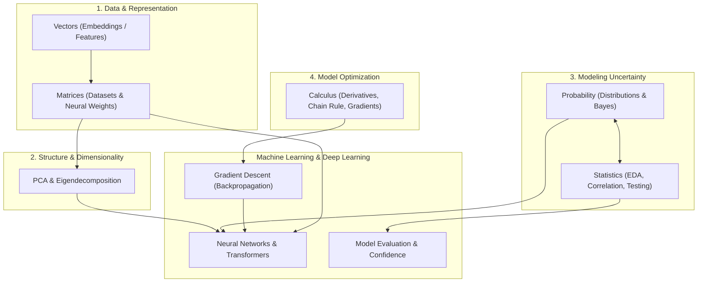

# 01-math: Mathematical Foundations of AI & Machine Learning

Mathematics is the language and engine of Artificial Intelligence. Every machine learning algorithm—from basic linear regression to modern Large Language Models and Vision Transformers—is built from fundamental operations in linear algebra, calculus, probability, and statistics.

This directory contains hands-on notes, theory, and Python practice exercises covering the foundational mathematics needed to understand, implement, and optimize machine learning algorithms from scratch.

---

## 🗺️ Roadmap & Modules

The math track is structured into 6 progressive modules:

| # | Module | Core Focus | Why it matters in ML / Deep Learning |
|---|---|---|---|
| 1 | **[Vectors](file:///Users/wakasa/Projects/AI-LAB/01-math/vectors/README.md)** | 1D Tensors, operations & metrics | Feature representation, word/image embeddings, similarity search (dot product, cosine similarity, Euclidean distance). |
| 2 | **[Matrices](file:///Users/wakasa/Projects/AI-LAB/01-math/matrix/README.md)** | 2D Tensors & Linear Transformations | Datasets ($X \in \mathbb{R}^{N \times D}$), linear layers ($Y = XW + b$), coordinate transformations, system solving. |
| 3 | **[PCA](file:///Users/wakasa/Projects/AI-LAB/01-math/pca/README.md)** | Dimensionality Reduction & Eigendecomposition | Compressing high-dimensional features, noise reduction, data visualization, covariance & eigenvalues/eigenvectors. |
| 4 | **[Calculus](file:///Users/wakasa/Projects/AI-LAB/01-math/calculus/README.md)** | Continuous change & Rates of change | Loss function optimization, Gradient Descent ($\theta \leftarrow \theta - \eta \nabla L$), Chain Rule as the foundation of Backpropagation. |
| 5 | **[Probability](file:///Users/wakasa/Projects/AI-LAB/01-math/probability/README.md)** | Reasoning under uncertainty (Deductive) | Classification outputs ($P(y \mid x)$), Bayesian inference, loss derivations (Cross-Entropy, Negative Log-Likelihood), generative models. |
| 6 | **[Statistics](file:///Users/wakasa/Projects/AI-LAB/01-math/statistics/README.md)** | Learning from data & validation (Inductive) | Exploratory Data Analysis (EDA), feature correlation, Z-score normalization, A/B testing, hypothesis tests, confidence intervals. |

---

## 📂 Directory Structure

```
01-math/
├── vectors/                        # Linear Algebra: 1D
│   ├── vector                      # What a vector and scalar are, representations
│   ├── addition                    # Component-wise addition and subtraction
│   ├── scalar-multiplication       # Scaling vectors
│   ├── dot-product                 # Dot product and geometric projection
│   ├── magnitude                   # Vector norm / length (L2 norm)
│   └── euclidean-distance          # Metric distance between points
│
├── matrix/                         # Linear Algebra: 2D
│   ├── matrix                      # Grid representations, shapes, indexing
│   ├── addition                    # Element-wise matrix addition
│   ├── scalar-multiplication       # Matrix scaling
│   ├── matrix-multiplication       # Dot product across rows and columns
│   ├── transpose                   # Swapping dimensions (X^T)
│   ├── matrix-vector               # Linear transformations: Ax = b
│   └── inverse                     # Determinants, identity matrix, invertibility
│
├── pca/                            # Spectral Theory & Dimensionality Reduction
│   ├── pca                         # Variance maximization and pipeline overview
│   ├── centering                   # Mean subtraction and zero-centering
│   ├── covariance                  # Variance, covariance formula, covariance matrix
│   ├── eigenvalues-eigenvectors    # Solving det(C - λI) = 0 and finding directions
│   ├── principal-components        # Sorting components by explained variance ratio
│   └── projection                  # Projecting samples onto lower-dimensional axes
│
├── calculus/                       # Optimization & Differential Calculus
│   ├── derivative                  # Rate of change, tangent slopes, limits
│   ├── power-rule                  # d/dx(x^n) = n * x^(n-1)
│   ├── sum-rule                    # Linearity of differentiation
│   ├── partial-derivatives         # Derivatives in multivariable spaces
│   ├── chain-rule                  # Derivatives of composite functions (Backprop)
│   └── gradient                    # Gradient vectors and Gradient Descent direction
│
├── probability/                    # Probability Theory
│   ├── probability                 # Sample spaces, events, complements, axioms
│   ├── conditional-probability     # P(A | B), independence, joint probability
│   ├── bayes-theorem               # Updating prior beliefs with observed evidence
│   ├── random-variables            # Discrete vs continuous variables, PMF, PDF, CDF
│   ├── distributions               # Bernoulli, Binomial, Uniform, Normal distributions
│   ├── expected-value              # Theoretical mean E[X]
│   ├── variance-standard-deviation # Theoretical spread Var(X) and std
│   └── covariance                  # Joint variability Cov(X, Y)
│
└── statistics/                     # Inferential & Descriptive Statistics
    ├── sampling                    # Populations vs samples, Central Limit Theorem
    ├── mean                        # Mean, median, mode, robust statistics
    ├── variance-std                # Sample variance (Bessel's correction n-1), std, SE
    ├── correlation                 # Pearson (r) & Spearman rank correlation
    ├── distributions               # Empirical distributions, Z-score standardization, t-dist
    ├── confidence-intervals        # Point estimates, margin of error, 95% CIs
    └── hypothesis-testing          # Null hypothesis H0, p-values, z-test, t-test, errors
```

---

## 🔗 How the Mathematics Connects in Machine Learning



1. **Vectors and Matrices** define how raw inputs (text, pixels, audio, tabular values) are encoded, transformed, and multiplied through model layers.
2. **Calculus** computes how each model parameter contributes to error, driving optimization via gradient descent.
3. **Probability** defines loss objectives (Maximum Likelihood Estimation, Cross-Entropy) and quantifies prediction confidence.
4. **Statistics** guides exploratory data analysis, hypothesis verification (A/B testing), metric significance, and feature selection.
5. **PCA** brings together linear algebra and statistical covariance to compress and interpret high-dimensional representations.

---

## 💻 How to Study

Each topic folder includes:
- **`README.md`**: Explains core intuition, formal definitions, formulas, and real-world ML context.
- **`practice.py` / `practice.txt`**: Hands-on Python coding exercises and manual calculations to build muscle memory from first principles without relying on high-level black-box libraries.
