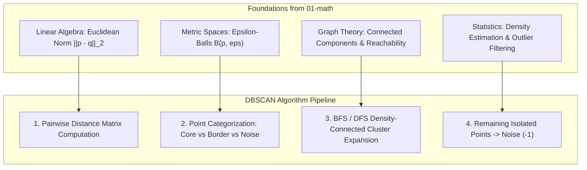

# DBSCAN: Density-Based Spatial Clustering of Applications with Noise

**DBSCAN** (Density-Based Spatial Clustering of Applications with Noise) is one of the most powerful, popular, and widely cited unsupervised machine learning algorithms for clustering and anomaly detection.

Unlike centroid-based algorithms like **K-Means** (which assume convex, spherical clusters and require specifying the number of clusters $k$ in advance), DBSCAN discovers clusters as **continuous areas of high point density separated by areas of low point density**. This enables DBSCAN to discover arbitrarily shaped clusters (such as intertwined rings, crescent moons, or winding manifolds) while simultaneously identifying and filtering sparse noise points as outliers.

---

## 🗺️ Roadmap & Modules

| # | Submodule | Core Concept | Why it matters in ML |
|---|---|---|---|
| 1 | **[Density-Based Clustering](density-based-clustering/README.md)** | Spatial density, $\epsilon$-neighborhood, and connectivity | How density-based paradigms break free from spherical geometry assumptions and discover complex cluster topologies. |
| 2 | **[Point Types](point-types/README.md)** | Core, Border, and Noise Points | The mathematical taxonomy categorizing every point based on local density threshold $|N_\epsilon(p)| \ge \text{min\_samples}$. |
| 3 | **[Parameters: eps & min_samples](parameters-eps-min-samples/README.md)** | Hyperparameter selection and the $k$-distance elbow curve | How $\epsilon$ and $\text{min\_samples}$ dictate cluster granularity, and how to use the sorted $k$-NN distance plot to choose optimal $\epsilon$. |
| 4 | **[Anomaly Detection](anomaly-detection/README.md)** | Native noise isolation (label $-1$) | Using DBSCAN as an unsupervised outlier detector without assuming Gaussian distributions or predefined global thresholds. |
| 5 | **[DBSCAN vs K-Means](dbscan-vs-kmeans/README.md)** | Architectural and geometric comparison | Detailed breakdown of when to choose DBSCAN vs K-Means: cluster shapes, outlier sensitivity, hyperparameter burden, and varying density trade-offs. |
| 6 | **[Feature Scaling](feature-scaling/README.md)** | Distance metric distortion and `StandardScaler` | Why distance-based density estimation breaks on unscaled features, and how standardization restores isotropic $\epsilon$-neighborhoods. |
| 7 | **[From Scratch](from-scratch/README.md)** | Complete NumPy implementation | Full object-oriented `DBSCANScratch` algorithm using BFS neighborhood expansion, validated directly against `scikit-learn`. |

---

## 📂 Directory Structure

```
02-ml/dbscan/
├── README.md                          # Top-level roadmap and architectural overview
├── density-based-clustering/           # Spatial density, epsilon-neighborhood, arbitrary geometries
│   ├── README.md
│   └── practice.py
├── point-types/                       # Core, Border, and Noise points taxonomy and reachability
│   ├── README.md
│   └── practice.py
├── parameters-eps-min-samples/        # Hyperparameter trade-offs, k-distance elbow heuristic
│   ├── README.md
│   └── practice.py
├── anomaly-detection/                 # Noise identification (label -1), outlier precision/recall
│   ├── README.md
│   └── practice.py
├── dbscan-vs-kmeans/                  # Convex vs non-convex clusters, outlier handling, complexity
│   ├── README.md
│   └── practice.py
├── feature-scaling/                   # Geometric distortion of epsilon-balls, StandardScaler
│   ├── README.md
│   └── practice.py
└── from-scratch/                      # Pure NumPy DBSCAN implementation & sklearn validation
    ├── README.md
    └── practice.py
```

---

## 🔗 How Math Connects to DBSCAN



---

## ⚡ Quick Intuition: The 3 Point Types

Given a neighborhood radius $\epsilon$ and density threshold $\text{min\_samples}$:

1. **Core Point ($p$)**: Has at least $\text{min\_samples}$ within distance $\epsilon$:
   $$\|N_\epsilon(p)\| \ge \text{min\_samples}$$
2. **Border Point ($b$)**: Has fewer than $\text{min\_samples}$ within $\epsilon$, but falls within the $\epsilon$-neighborhood of at least one Core Point.
3. **Noise Point ($n$)**: Neither a Core Point nor a Border Point (isolated point, label $-1$).

Clusters grow by chaining core points together: if $p$ is a core point, it pulls its entire $\epsilon$-neighborhood into its cluster, recursively expanding through any adjacent core points.

