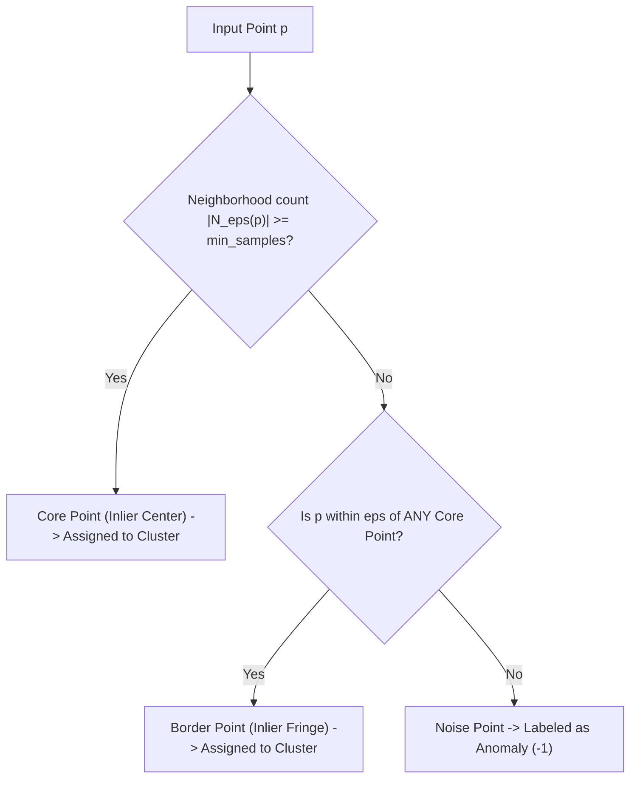

# Anomaly & Outlier Detection with DBSCAN

In addition to clustering, **DBSCAN is a powerful unsupervised anomaly detection algorithm**. While algorithms like K-Means force every single point into a cluster (even distant outliers), DBSCAN natively isolates low-density points into a dedicated **Noise category (label $-1$)**.

This makes DBSCAN naturally suited for fraud detection, network intrusion monitoring, manufacturing defect discovery, and data cleaning.

---

## 🔎 Why Density-Based Anomaly Detection?

Traditional outlier detection methods rely on strong assumptions about data distribution that often fail in real-world scenarios:

| Method | Approach | Underlying Assumption | Where it Fails |
|---|---|---|---|
| **$Z$-Score / 3-$\sigma$** | Global distance from mean: $z = \frac{\|x - \mu\|}{\sigma} > 3$ | Unimodal Gaussian distribution | Fails on multimodal data (multiple normal operating regimes) |
| **Mahalanobis Distance** | Covariance-adjusted distance: $D_M(x) = \sqrt{(x-\mu)^T \Sigma^{-1}(x-\mu)}$ | Single elliptical Gaussian ellipsoid | Fails on non-linear manifolds, distorted by extreme outliers |
| **K-Means Distance** | Distance to nearest centroid: $\|x - \mu_k\|_2$ | Convex, spherical clusters of equal size | Outliers pull cluster centroids towards themselves |
| **DBSCAN (Noise $-1$)** | Local density threshold: $|N_\epsilon(p)| < \text{min\_samples}$ (no core reachability) | **None** (non-parametric, multi-modal, arbitrary shapes) | Struggles when normal clusters have widely varying densities |

---

## ⚙️ The DBSCAN Outlier Mechanism

A point $p$ is flagged as an anomaly ($\hat{y} = 1$) if and only if:
$$\text{DBSCAN}(p) = -1 \iff |N_\epsilon(p)| < \text{min\_samples} \quad \text{and} \quad \forall c \in N_\epsilon(p), c \notin \text{CorePoints}$$

---

## 📊 Evaluating Anomaly Detection Performance

Because anomalies are typically rare, standard classification accuracy is misleading (the *accuracy paradox*). We evaluate DBSCAN outlier detection using **Precision**, **Recall**, and the harmonic mean **F1-Score**:

$$\text{Precision} = \frac{\text{TP}}{\text{TP} + \text{FP}} = \frac{\text{Correctly Detected Anomalies}}{\text{All Points Flagged as Anomalies}}$$

$$\text{Recall} = \frac{\text{TP}}{\text{TP} + \text{FN}} = \frac{\text{Correctly Detected Anomalies}}{\text{All Actual Anomalies Present}}$$

$$F_1 = 2 \cdot \frac{\text{Precision} \cdot \text{Recall}}{\text{Precision} + \text{Recall}}$$

### Tuning the Anomaly Detection Sensitivity:
- **Higher Recall (Catch more anomalies, tolerate false alarms):**
  - Increase $\text{min\_samples}$ (requires higher density to be considered normal).
  - Decrease $\epsilon$ (requires closer proximity to be considered normal).
- **Higher Precision (Zero false alarms, tolerate missing subtle anomalies):**
  - Decrease $\text{min\_samples}$ (easier to form a valid cluster).
  - Increase $\epsilon$ (wider neighborhood absorbs looser peripheral points).

---

## 💡 Multimodal Anomaly Detection: DBSCAN vs Global Z-Score

Consider a financial transaction system with two normal modes:
1. **Micro-transactions**: Small amounts (\$1–\$20) occurring with high frequency.
2. **Business transactions**: Large amounts (\$5,000–\$10,000) occurring during working hours.

- **Global $Z$-Score failure:** The global mean is $\approx \$2,500$. Normal \$8,000 business transactions might be falsely flagged as outliers ($z > 3$), while subtle fraudulent transactions in between modes (\$1,200) go completely unnoticed!
- **DBSCAN success:** Recognizes both \$10 micro-transactions and \$8,000 business transactions as two separate dense clusters. Any transaction that falls into the empty space between or around them is correctly flagged as noise ($label = -1$).

