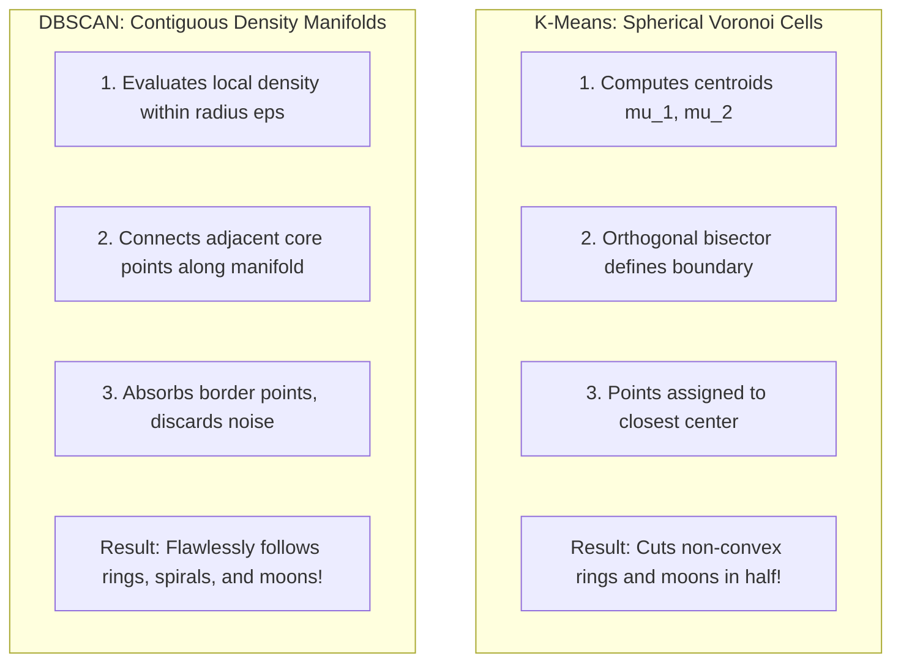

# DBSCAN vs. K-Means: Architectural & Geometric Comparison

Choosing between **K-Means** (partition-based) and **DBSCAN** (density-based) is one of the most fundamental architectural decisions in unsupervised machine learning. Each algorithm embodies an entirely distinct philosophy of what constitutes a "cluster."

---

## 🏛️ Comprehensive Architectural Comparison

| Dimension | K-Means | DBSCAN | Winner / Best Fit |
|---|---|---|---|
| **Cluster Definition** | Partition around $k$ central prototypes (centroids $\mu_k$) | Contiguous dense regions separated by sparse areas | Depends on data geometry |
| **Number of Clusters ($k$)** | **Must be pre-specified** manually before training | **Discovered automatically** from $(\epsilon, \text{min\_samples})$ | **DBSCAN** (no guesswork on $k$) |
| **Cluster Geometry** | **Convex & spherical** (linear Voronoi cell boundaries) | **Arbitrary shapes** (crescents, rings, manifolds, ribbons) | **DBSCAN** (no shape restrictions) |
| **Outlier & Noise Handling** | **Forced assignment**: every outlier is assigned to a cluster, skewing centroids | **Native noise filtering**: isolated points assigned label $-1$ | **DBSCAN** (robust to noise) |
| **Clusters with Varying Density** | Handles well (minimizes global inertia across all points) | **Struggles**: a single global $\epsilon$ cannot fit dense and sparse clusters simultaneously | **K-Means** (or HDBSCAN) |
| **Computational Complexity** | $O(t \cdot k \cdot N \cdot d)$ (linear in $N$, extremely fast) | $O(N^2 \cdot d)$ naive, $O(N \log N \cdot d)$ with KD-tree ($d \le 10$) | **K-Means** (scales to billions of points) |
| **High Dimensionality ($d \gg 10$)** | Works reasonably well (e.g., embeddings) | Suffers from *Curse of Dimensionality* (distances become uniform) | **K-Means** |
| **Predicting on Unseen Data** | Trivial: assign to nearest centroid in $O(k \cdot d)$ | Non-trivial: requires checking proximity to all stored core points | **K-Means** |

---

## 📐 Geometric Comparison: Convex vs. Non-Convex



### The Concentric Ring Failure Mode:
- In concentric circles (inner disk + outer ring), both clusters share roughly the **same centroid** at the origin $(0, 0)$.
- **K-Means** attempts to draw a straight line splitting the space into left and right halves, mixing inner and outer points in both clusters.
- **DBSCAN** traverses the density connectivity along the outer ring independently from the inner disk, separating them perfectly.

---

## ⚡ The Varying Density Dilemma: Where DBSCAN Stumbles

The primary vulnerability of DBSCAN is its reliance on a **single global spatial radius $\epsilon$**:

```
[ Very Dense Cluster A ]           [ Very Sparse Cluster B ]
(Points spaced 0.1 apart)          (Points spaced 1.5 apart)
```

1. If you set $\epsilon = 0.2$ to isolate Cluster A:
   - Cluster A is detected correctly.
   - Cluster B is completely rejected as **Noise** because its inter-point spacing exceeds $\epsilon$.
2. If you set $\epsilon = 1.8$ to capture Cluster B:
   - Cluster B is detected correctly.
   - Cluster A, background noise, and nearby clusters are **merged into one massive blob**.

> [!TIP]
> When your dataset contains clusters with significantly varying densities, consider **OPTICS** (Ordering Points To Identify the Clustering Structure) or **HDBSCAN** (Hierarchical DBSCAN), which compute density hierarchies across varying $\epsilon$ scales.

---

## 🎯 Practical Decision Rule

Use **K-Means** when:
- The data is large ($N > 10^5$), high-dimensional ($d > 50$), or streaming.
- You have strong reason to believe clusters are globular/spherical.
- You need fast inference on new, unseen incoming samples.

Use **DBSCAN** when:
- You do not know the true number of clusters in advance.
- Clusters have arbitrary, elongated, or non-linear geometric topologies.
- The dataset contains noise, measurement artifacts, or outliers that must be filtered out.

