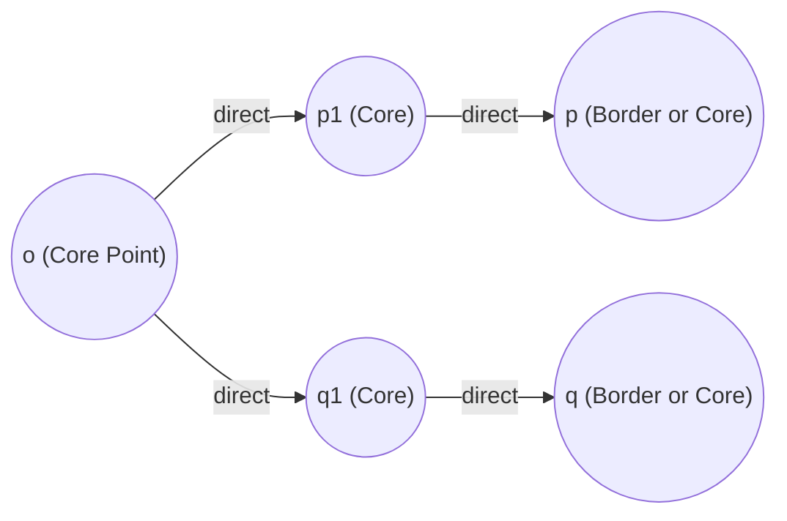

# Density-Based Clustering

**Density-Based Clustering** is an unsupervised learning paradigm where clusters are defined as continuous, high-density regions of points in space separated by low-density regions (empty space or sparse noise).

Unlike centroid-based clustering (such as K-Means), which partitions data into convex Voronoi cells around central prototypes, density-based algorithms do not impose geometric assumptions on cluster shapes. They can effortlessly uncover arbitrarily shaped clusters: nested concentric rings, winding ribbons, crescent moons, or high-dimensional manifolds.

---

## 🎯 Why Density-Based Clustering?

Consider the limitations of traditional clustering paradigms:

| Clustering Paradigm | Representative Algorithm | Assumptions | Geometric Limitations | Noise Handling |
|---|---|---|---|---|
| **Centroid-Based** | K-Means, K-Medoids | Clusters are convex, spherical, roughly equal size | Fails on non-convex shapes (e.g. concentric circles, moons) | Sensitive: forced to assign every outlier to a cluster |
| **Distribution-Based**| Gaussian Mixture Models | Data is generated by a mixture of Gaussians | Assumes elliptical cluster shapes | Sensitive: low-probability points still belong to a component |
| **Hierarchical** | Agglomerative / Divisive | Nested tree structure (dendrogram) | High time complexity $O(N^3)$ or $O(N^2)$, linkage chaining | Varying sensitivity depending on linkage criteria |
| **Density-Based** | **DBSCAN**, OPTICS, HDBSCAN | Clusters are contiguous dense regions | **No shape assumptions** (discovers arbitrary topologies) | **Native outlier filtering**: sparse points labeled as noise |

---

## 📐 Mathematical Formulation

Let $D \subset \mathbb{R}^d$ be a dataset of $N$ points in $d$-dimensional Euclidean space with distance metric $\text{dist}(p, q) = \|p - q\|_2$.

### 1. $\epsilon$-Neighborhood
The **$\epsilon$-neighborhood** of a point $p$, denoted $N_\epsilon(p)$, is the closed ball of radius $\epsilon$ centered at $p$:

$$N_\epsilon(p) = \{ q \in D \mid \text{dist}(p, q) \le \epsilon \}$$

The cardinality $|N_\epsilon(p)|$ represents the **local sample density** around $p$. Notice that $p \in N_\epsilon(p)$ always holds, so $|N_\epsilon(p)| \ge 1$.

---

### 2. Directly Density-Reachable
A point $q$ is **directly density-reachable** from a point $p$ with respect to parameters $\epsilon$ and $\text{min\_samples}$ if and only if:
1. $p$ is a **Core Point**:
   $$|N_\epsilon(p)| \ge \text{min\_samples}$$
2. $q$ lies within the $\epsilon$-neighborhood of $p$:
   $$q \in N_\epsilon(p)$$

> [!NOTE]
> Direct reachability is **asymmetric**! If $p$ is a core point and $q$ is a border point (not a core point), then $q$ is directly reachable from $p$, but $p$ is **not** directly reachable from $q$.

---

### 3. Density-Reachable
A point $q$ is **density-reachable** from a point $p$ with respect to $\epsilon$ and $\text{min\_samples}$ if there exists a finite chain of points $p_1, p_2, \dots, p_n \in D$ such that:
- $p_1 = p$
- $p_n = q$
- Each $p_{i+1}$ is directly density-reachable from $p_i$ (for all $1 \le i < n$).

All intermediate points $p_1, \dots, p_{n-1}$ must be **core points**.

---

### 4. Density-Connected
A point $p$ is **density-connected** to a point $q$ with respect to $\epsilon$ and $\text{min\_samples}$ if there exists an intermediate point $o \in D$ such that **both** $p$ and $q$ are density-reachable from $o$.

> [!TIP]
> Unlike density-reachability, **density-connectivity is symmetric**: if $p$ is density-connected to $q$, then $q$ is density-connected to $p$. This symmetric relation defines the equivalence classes that form distinct **clusters**.

---

## 🏛️ Definition of a Cluster in DBSCAN

A cluster $C \subseteq D$ with respect to $\epsilon$ and $\text{min\_samples}$ is defined as a non-empty subset of $D$ satisfying two fundamental conditions:

1. **Maximality**:
   $$\forall p, q \in D: \quad \text{if } p \in C \text{ and } q \text{ is density-reachable from } p, \text{ then } q \in C$$
2. **Connectivity**:
   $$\forall p, q \in C: \quad p \text{ is density-connected to } q$$

Any point $n \in D$ that does not belong to any cluster $C$ is classified as **Noise**:
$$\text{Noise} = \{ n \in D \mid \forall C_k, n \notin C_k \}$$

---

## 🔬 Arbitrary Topology Discovery

Because clusters are defined through density connectivity rather than distance to a central prototype, density-based clustering excels at:
- **Concentric rings**: inner circle vs outer ring (impossible for K-Means).
- **Interlocking crescents**: two intertwining half-moons.
- **Varying cluster sizes**: small tight clusters alongside long thin ribbons.
- **Outlier suppression**: ambient noise points with $|N_\epsilon(p)| < \text{min\_samples}$ are dropped automatically.

