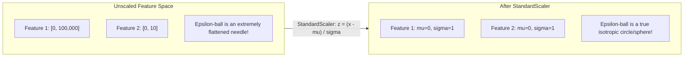

# The Impact of Feature Scaling on DBSCAN

**DBSCAN is acutely sensitive to the scale of input features.** Unlike tree-based algorithms (such as Decision Trees and Random Forests, which evaluate splits along one coordinate at a time and are completely scale-invariant), DBSCAN relies directly on the **multivariate Euclidean distance metric**:

$$\text{dist}(p, q) = \|p - q\|_2 = \sqrt{\sum_{j=1}^d (p_j - q_j)^2}$$

When features have disparate units or variances, unscaled Euclidean distance leads to catastrophic geometric distortion of the $\epsilon$-neighborhood.

---

## 💥 The Distortion of the $\epsilon$-Neighborhood

The condition for inclusion in an $\epsilon$-neighborhood is:

$$\sum_{j=1}^d (p_j - q_j)^2 \le \epsilon^2$$

In an unscaled feature space where Feature 1 has a range of $[0, 100\,000]$ (e.g. Annual Income in dollars) and Feature 2 has a range of $[0, 10]$ (e.g. Years of Education):

$$(p_1 - q_1)^2 + (p_2 - q_2)^2 \le \epsilon^2$$

1. An income difference of just $\$100$ produces $(100)^2 = 10\,000$.
2. The entire dynamic range of education (max difference $10$) squared is only $10^2 = 100$.
3. **The income feature contributes $99.9\%$ of the distance metric**, completely overriding education.
4. Geometrically, what should be an isotropic spherical neighborhood $B_\epsilon(p)$ becomes a **flattened hyper-ellipsoid**: points that differ widely on Feature 2 are considered "close neighbors" as long as their Feature 1 matches within $\epsilon$.

---

## 🛠️ Standardization: `StandardScaler` vs `MinMaxScaler`

| Method | Formula | Properties in DBSCAN | Outlier Sensitivity |
|---|---|---|---|
| **StandardScaler** | $z_j = \frac{x_j - \mu_j}{\sigma_j}$ | Mean $= 0$, Unit variance $\sigma^2 = 1$. Preserves relative outlier distances. | **Robust**: Best choice for DBSCAN |
| **MinMaxScaler** | $z_j = \frac{x_j - x_{\min}}{x_{\max} - x_{\min}}$ | Bounds features to $[0, 1]$. Highly compressed by severe outliers. | **Fragile**: Extreme outliers compress genuine clusters into tiny intervals |

> [!IMPORTANT]
> Always standardize features using **`StandardScaler`** before running DBSCAN. If you use `MinMaxScaler`, a single extreme outlier at $x = 1\,000\,000$ will compress all normal cluster points into $[0, 0.001]$, destroying the local density contrast needed to choose a stable $\epsilon$.

---

## 📋 Algorithm Scaling Invariance Matrix

To put DBSCAN in perspective across Machine Learning:

| Algorithm | Distance-Based? | Requires Feature Scaling? | Reason |
|---|---|---|---|
| **Linear Regression (Analytical)** | No | No (optional for conditioning) | Normal Equation is scale-invariant |
| **Linear Regression (Grad Descent)**| No | **Yes** | Speed of gradient descent convergence |
| **KNN** | **Yes** | **Yes (Mandatory)** | Euclidean distance dominated by large features |
| **K-Means** | **Yes** | **Yes (Mandatory)** | Centroid Euclidean distance distorted |
| **Decision Trees** | No | **No (Completely Invariant)**| Rank-based continuous midpoint splits |
| **Random Forest** | No | **No (Completely Invariant)**| Inherits tree scale invariance |
| **DBSCAN** | **Yes** | **Yes (Mandatory)** | $\epsilon$-ball distorted into flattened ellipsoid |
| **SVM (RBF Kernel)** | **Yes** | **Yes (Mandatory)** | Kernel $K(x, y) = \exp(-\gamma \|x-y\|^2)$ is distance-based |

