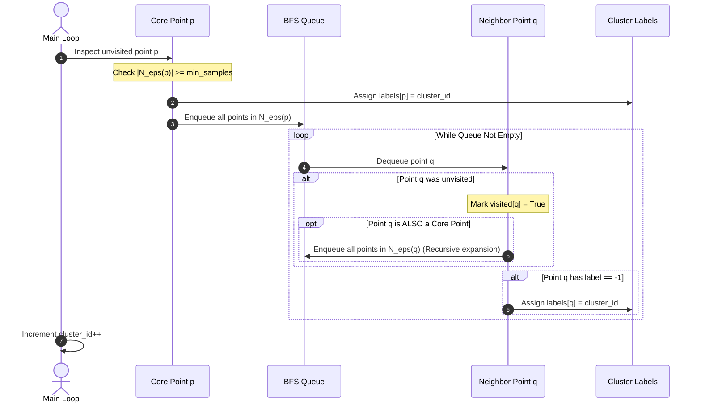

# DBSCAN from Scratch in Pure NumPy

This module provides a complete, object-oriented implementation of the **DBSCAN** (Density-Based Spatial Clustering of Applications with Noise) algorithm from first principles using pure Python and NumPy, adhering to the standard scikit-learn estimator interface (`fit` and `fit_predict`).

---

## 📐 Algorithmic Breakdown & Pseudocode

The DBSCAN algorithm operates by iteratively discovering density-connected components using Breadth-First Search (BFS) neighborhood expansion:

```
Algorithm: DBSCAN(X, eps, min_samples)
------------------------------------------------------------------------
Input:
    X: Data matrix of shape (N, d)
    eps: Neighborhood distance threshold (float > 0)
    min_samples: Minimum neighborhood density threshold (int >= 1)

Output:
    labels: Array of shape (N,) where -1 indicates noise, and 0..K-1 are cluster IDs
    core_sample_indices: Indices of all identified core points

1. Compute pairwise distance matrix D where D[i, j] = ||X[i] - X[j]||_2
2. Compute epsilon-neighborhoods for each point i:
       N_eps(i) = { j in 0..N-1 | D[i, j] <= eps }
3. Identify core points:
       is_core[i] = (|N_eps(i)| >= min_samples)
4. Initialize labels = [-1, -1, ..., -1] (all points assumed noise initially)
5. Initialize visited = [False, False, ..., False]
6. Initialize cluster_id = 0

7. For each point i from 0 to N-1:
       If visited[i]:
           Continue
       visited[i] = True

       If not is_core[i]:
           Continue  // Remains noise (-1) unless reached by a core point later

       // Point i is an unvisited core point: Start a new cluster!
       labels[i] = cluster_id
       Initialize queue = list(N_eps(i))

       While queue is not empty:
           Pop neighbor q from queue
           If not visited[q]:
               visited[q] = True
               If is_core[q]:
                   // Core neighbor expands the cluster!
                   queue.extend(N_eps(q))

           // If point q was unassigned or marked as noise, adopt it
           If labels[q] == -1:
               labels[q] = cluster_id

       cluster_id += 1

8. Return labels, where(is_core)[0]
```

---

## 🔄 The BFS Queue Cluster Expansion Mechanism



---

## ⚡ Computational Complexity & Memory

| Metric | Full Distance Matrix (Implemented) | Spatial Indexing (KD-Tree / Ball-Tree) |
|---|---|---|
| **Pairwise Distance Computation** | $O(N^2 \cdot d)$ (vectorized matrix operation) | $O(N \log N \cdot d)$ (tree construction) |
| **Neighborhood Queries** | $O(1)$ lookup into precomputed matrix | $O(\log N)$ tree range query |
| **Total Time Complexity** | $\mathcal{O}(N^2 \cdot d)$ | $\mathcal{O}(N \log N \cdot d)$ (for $d \le 10$) |
| **Space Complexity** | $\mathcal{O}(N^2)$ distance matrix | $\mathcal{O}(N \cdot d)$ tree memory |

> [!NOTE]
> The precomputed pairwise distance matrix approach implemented here is ideal for datasets up to $N \sim 10^4$ points, as fully vectorized NumPy array operations run at native C-speed with zero Python loop overhead. For massive datasets ($N > 10^5$), spatial trees like KD-Trees or BallTrees prevent allocating the $O(N^2)$ memory buffer.

