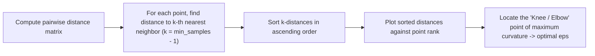
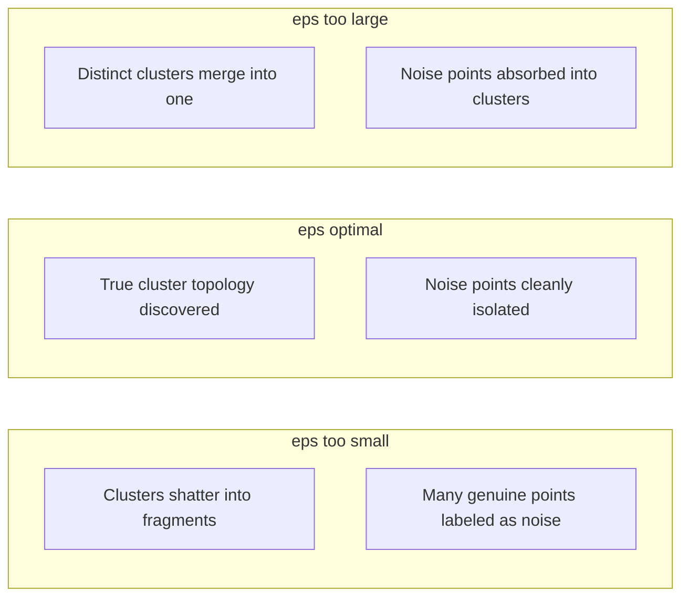

# Hyperparameters: eps ($\epsilon$) and min_samples

DBSCAN requires two primary hyperparameters:
1. **$\epsilon$ (`eps`)**: The maximum radius of a neighborhood.
2. **$\text{min\_samples}$**: The minimum number of points required within the $\epsilon$-neighborhood to designate a point as a **Core Point**.

Unlike K-Means (where you must pre-specify the number of clusters $k$), DBSCAN automatically determines the number of clusters from the spatial density dictated by these two parameters.

---

## 🎛️ The Physical Meaning of Density

In $d$-dimensional Euclidean space, the volume of a hypersphere of radius $\epsilon$ is:

$$V_d(\epsilon) = \frac{\pi^{d/2}}{\Gamma\left(\frac{d}{2} + 1\right)} \cdot \epsilon^d$$

The threshold density $\rho_{\text{crit}}$ required for cluster formation is roughly:

$$\rho_{\text{crit}} \approx \frac{\text{min\_samples}}{V_d(\epsilon)}$$

- Increasing $\text{min\_samples}$ with fixed $\epsilon \implies$ raises the required density (filters out looser clusters).
- Increasing $\epsilon$ with fixed $\text{min\_samples} \implies$ lowers the required density (merges neighboring clusters).

---

## 🧭 Heuristic Guidelines for `min_samples`

As a rule of thumb based on the original DBSCAN paper (Ester et al., 1996) and subsequent literature:

| Criterion | Recommendation | Reason |
|---|---|---|
| **Theoretical Lower Bound** | $\text{min\_samples} \ge d + 1$ | In $d$ dimensions, a cluster must contain at least a simplex ($d+1$ points) to define a non-degenerate volume. |
| **Default Rule of Thumb** | $\text{min\_samples} = 2 \times d$ | For 2D data, $\text{min\_samples} = 4$. For 3D data, $\text{min\_samples} = 6$. |
| **Noisy / Large Datasets** | $\text{min\_samples} \gg 2d$ (e.g. 10 to 50) | Larger values suppress spurious micro-clusters formed by random noise fluctuations. |
| **Domain Knowledge** | Expected minimum cluster size | If clusters with $< 20$ points are considered noise in your application, set $\text{min\_samples} \ge 20$. |

> [!WARNING]
> Setting $\text{min\_samples} \le 2$ reduces DBSCAN to **single-linkage hierarchical clustering**, which is notoriously vulnerable to the "chaining effect" (a single bridge of noise points connecting two completely distinct clusters). Always set $\text{min\_samples} \ge 3$.

---

## 📈 The $k$-Distance Elbow Method for Selecting $\epsilon$

Once $\text{min\_samples}$ is fixed (typically to $2d$), $\epsilon$ can be chosen systematically using the **$k$-distance graph**:

### Mathematical Interpretation of the $k$-Distance Curve:
1. **Flat Plateau ($d_{(i)} \le \epsilon$)**: Core points belonging to dense clusters. Their $k$-th neighbors are close by.
2. **Sharp Elbow / Knee**: The critical threshold $\epsilon^*$ separating intra-cluster points from ambient background noise.
3. **Steep Tail ($d_{(i)} > \epsilon$)**: Sparse noise points and outliers. Their $k$-th neighbors are far away.

---

## ⚖️ Parameter Sensitivity & Failure Modes

| Parameter Setting | Effect on Clusters | Effect on Outliers | Consequence |
|---|---|---|---|
| **$\epsilon$ too small** | Fractured into many micro-clusters | Excessive false-positive noise | Under-clustering / Over-filtering |
| **$\epsilon$ optimal** | Accurate natural boundaries | True outliers filtered | Optimal separation |
| **$\epsilon$ too large** | Merged into 1 giant cluster | Outliers absorbed into clusters | Over-clustering / No noise isolation |
| **$\text{min\_samples}$ too small** | Noisy clusters created | Very few outliers detected | Sensitive to random noise spikes |
| **$\text{min\_samples}$ too large** | Low-density clusters rejected | Valid clusters dropped as noise | Strict, misses loose clusters |

