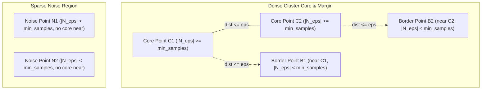

# Point Types: Core, Border, and Noise Points

At the heart of the DBSCAN algorithm lies an elegant, discrete tripartite taxonomy: every point in the dataset belongs to exactly one of three categories: **Core Point**, **Border Point**, or **Noise Point**.

This classification determines whether a point can initiate cluster discovery, extend an existing cluster along its periphery, or be discarded as an unclustered outlier.

---

## 🧭 The Tripartite Point Taxonomy

Given a metric distance function $\text{dist}(p, q) = \|p - q\|_2$, a neighborhood radius $\epsilon > 0$, and a minimum density threshold $\text{min\_samples} \ge 1$:

Let $N_\epsilon(p) = \{ q \in D \mid \text{dist}(p, q) \le \epsilon \}$ be the set of points within distance $\epsilon$ of $p$ (including $p$ itself).

| Point Type | Mathematical Condition | Role in Clustering | Cluster Initiation? |
|---|---|---|---|
| **Core Point** ($C$) | $|N_\epsilon(p)| \ge \text{min\_samples}$ | Dense interior of a cluster | **Yes** — can start & expand clusters |
| **Border Point** ($B$) | $|N_\epsilon(p)| < \text{min\_samples}$ and $\exists c \in N_\epsilon(p)$ s.t. $c$ is a Core Point | Edge / boundary of a cluster | **No** — absorbed by adjacent core point |
| **Noise Point** ($N$) | $|N_\epsilon(p)| < \text{min\_samples}$ and $\forall q \in N_\epsilon(p)$, $q$ is **not** a Core Point | Outlier / anomaly (unclustered) | **No** — assigned label $-1$ |

---

## 📐 Geometric Visualization



---

## ⚡ Mathematical Reachability & Asymmetry

Understanding the difference between Core and Border points clarifies why reachability in DBSCAN is **not** an equivalence relation:

### 1. Asymmetry of Direct Density-Reachability
Suppose $c$ is a **Core Point** and $b$ is a **Border Point** within $c$'s $\epsilon$-ball:
- $b \in N_\epsilon(c)$ and $|N_\epsilon(c)| \ge \text{min\_samples} \implies b$ is **directly density-reachable** from $c$.
- However, $|N_\epsilon(b)| < \text{min\_samples} \implies c$ is **NOT** directly density-reachable from $b$.

> [!IMPORTANT]
> A border point cannot pull other points into a cluster because it lacks sufficient local density. It can only be pulled into a cluster by a neighboring core point.

### 2. Density-Connectedness Restores Symmetry
To form valid clusters as equivalence classes, DBSCAN defines **Density-Connectedness**:
- Points $p$ and $q$ are density-connected if there exists an anchor point $o$ such that both $p$ and $q$ are density-reachable from $o$.
- If $p$ and $q$ are border points of the same cluster, neither can reach the other directly, but both are reached by core points originating from $o$.

---

## ⚠️ The Border Point Tie-Breaking Phenomenon

What happens if a border point $b$ lies within distance $\epsilon$ of **two different core points** $c_1 \in \text{Cluster } 1$ and $c_2 \in \text{Cluster } 2$?

```
[Cluster 1 Core] ----(eps)----> [ Border Point b ] <----(eps)---- [Cluster 2 Core]
```

- $b$ satisfies the border condition for both clusters.
- Because DBSCAN processes points sequentially, $b$ is assigned to whichever cluster encounters it **first** during neighborhood expansion.
- **Consequence:** DBSCAN cluster assignments for border points can depend slightly on dataset visiting order! Core points and noise points, by contrast, are 100% deterministic regardless of point ordering.

