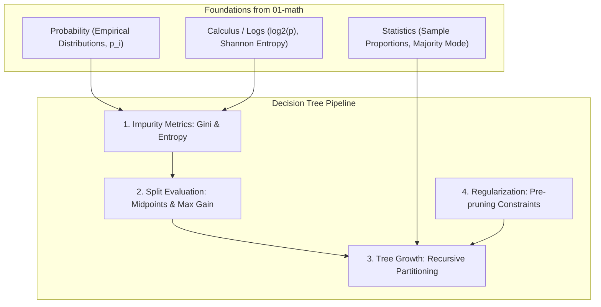

# Decision Trees

**Decision Trees** are non-parametric supervised learning models used for both **classification** and **regression**. They partition the feature space into hierarchical, axis-aligned rectangular regions through a sequence of intuitive, binary "if-then-else" decisions.

This folder contains practice exercises and conceptual notes covering Decision Trees from first principles: tree architecture (nodes, branches, leaves), impurity criteria (Gini Impurity and Shannon Entropy), greedy split finding, early-stopping hyperparameters (`max_depth`, `min_samples_leaf`), overfitting, pre-pruning vs post-pruning, and a complete object-oriented implementation from scratch in pure NumPy.

Each subfolder has:
- `README.md` — theory, intuition, mathematical formulas, and examples
- `practice.py` — hands-on Python exercises implemented from first principles

---

## 🗺️ Roadmap & Modules

| # | Submodule | Core Concept | Why it matters in ML |
|---|---|---|---|
| 1 | **[Tree Structure](tree-structure/README.md)** | Root, internal nodes, branches & leaves | How hierarchical binary decision rules partition feature space and provide $O(\text{depth})$ inference. |
| 2 | **[Gini Impurity](gini-impurity/README.md)** | $G = 1 - \sum p_i^2$ | The default CART impurity metric measuring label mixture and evaluating candidate splits via Gini Gain. |
| 3 | **[Entropy & Information Gain](entropy-and-information-gain/README.md)** | $H(S) = -\sum p_i \log_2 p_i$ | Information theory metric measuring surprise/uncertainty in bits, and comparing Gini vs Entropy. |
| 4 | **[Split Finding](split-finding/README.md)** | Exhaustive search on midpoints $\theta_k$ | How greedy recursive splitting selects features, and why trees are invariant to feature scaling. |
| 5 | **[Hyperparameters](hyperparameters/README.md)** | `max_depth`, `min_samples_leaf`, etc. | Pre-pruning stopping rules that constrain tree growth and regulate model complexity. |
| 6 | **[Overfitting & Pruning](overfitting-and-pruning/README.md)** | Pre-pruning vs Cost-Complexity Pruning | Why unconstrained trees memorize training noise ($100\%$ train accuracy) and how pruning restores generalization. |
| 7 | **[From Scratch](from-scratch/README.md)** | Complete NumPy CART implementation | Full recursive `DecisionTreeClassifier` with ASCII rule printing and exact matching performance to scikit-learn. |

---

## 📂 Directory Structure

```
decision-trees/
├── tree-structure              # Root, internal decision nodes, branches, leaves, traversal
├── gini-impurity               # Gini impurity definition, pure nodes, weighted split Gini
├── entropy-and-information-gain # Shannon entropy, Information Gain, comparison with Gini
├── split-finding               # Continuous midpoint search, greedy splitting, scale invariance
├── hyperparameters             # max_depth, min_samples_split, min_samples_leaf
├── overfitting-and-pruning     # High variance, pre-pruning vs post-pruning (ccp_alpha)
└── from-scratch                # Complete DecisionTreeClassifier class from scratch
```

---

## 🔗 How Math Connects to Decision Trees



1. **Probability (`01-math/probability`)**: Empirical class proportions $p_i = \frac{N_i}{N}$ form the basis of both Gini Impurity and Shannon Entropy.
2. **Calculus / Logarithms (`01-math/calculus`)**: Logarithms in base 2 calculate entropy $H(S) = -\sum p_i \log_2(p_i)$ to quantify information gain.
3. **Statistics (`01-math/statistics`)**: The statistical mode (majority vote) determines predictions at terminal leaf nodes.

---

## 🧭 Learning Path

Work through the submodules in numbered order:
1. Start with **[Tree Structure](tree-structure/README.md)** to grasp the node-branch-leaf architecture and fast inference.
2. Study **[Gini Impurity](gini-impurity/README.md)** to learn how purity is mathematically quantified.
3. Explore Information Theory in **[Entropy & Information Gain](entropy-and-information-gain/README.md)**.
4. Understand how algorithms find optimal thresholds in **[Split Finding](split-finding/README.md)**.
5. Learn how constraints prevent overfitting in **[Hyperparameters](hyperparameters/README.md)** and **[Overfitting & Pruning](overfitting-and-pruning/README.md)**.
6. Assemble the complete recursive algorithm in **[From Scratch](from-scratch/README.md)**.

