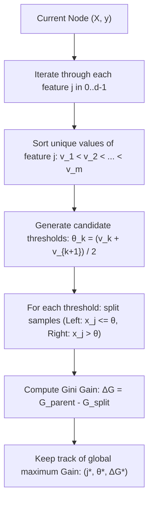

# Split Finding: How Trees Choose Features and Thresholds

A Decision Tree builds its structure using **Greedy Recursive Binary Splitting**. At each step, it exhaustively scans all available features and possible threshold values to find the single split that maximizes impurity reduction.

---

## 1. The Split Finding Algorithm

Given a node containing features $\mathbf{X} \in \mathbb{R}^{n \times d}$ and labels $\mathbf{y} \in \{0, 1\}^n$:

---

## 2. Generating Candidate Thresholds

If feature $j$ contains continuous values $[1.2, 3.4, 2.0, 3.4, 5.0]$:
1. Extract unique values and sort: $[1.2, 2.0, 3.4, 5.0]$
2. Compute midpoints between consecutive values:
   - $\theta_1 = \frac{1.2 + 2.0}{2} = 1.6$
   - $\theta_2 = \frac{2.0 + 3.4}{2} = 2.7$
   - $\theta_3 = \frac{3.4 + 5.0}{2} = 4.2$

Testing these 3 midpoints is mathematically guaranteed to test every possible partition of the samples along that feature axis.

---

## 3. Why Greedy?

Building the globally optimal decision tree (considering all future downstream split consequences simultaneously) is an **NP-complete problem**.

Therefore, CART adopts a **greedy heuristic**:
- At each step, it chooses the split that yields the largest **immediate** impurity reduction.
- It never backtracks or reconsiders earlier splits.
- While not guaranteed to find the global optimum, the greedy strategy works exceptionally well in practice.

---

## 4. Key Property: Scale Invariance

Because decision trees evaluate candidate splits solely by ordering thresholds ($x_j \leq \theta$):
- **Decision trees are completely invariant to feature scaling.**
- Multiplying a feature by $1,000$, standardizing it via $Z$-score, or applying any monotonic transformation $f(x)$ preserves the exact same relative ordering of samples.
- Unlike KNN or Logistic Regression, Decision Trees **do not require StandardScaler**.

---

## Summary

- Trees test every feature and every adjacent midpoint threshold.
- The split that maximizes Gini Gain or Information Gain is chosen greedily.
- Because splits only depend on value order, feature scaling is unnecessary for decision trees.

**Previous:** [Entropy & Information Gain](../entropy-and-information-gain/README.md) · **Next:** [Hyperparameters](../hyperparameters/README.md)

