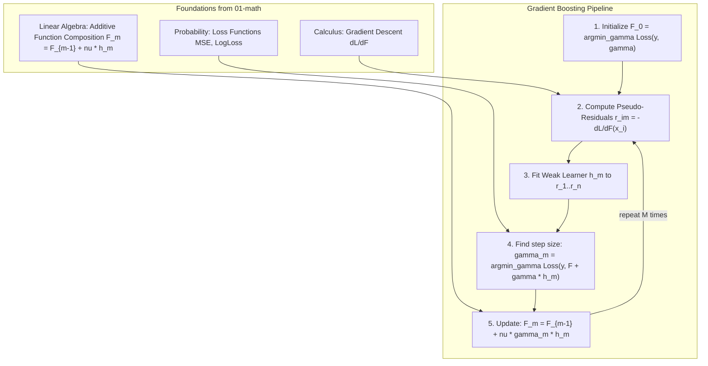

# Gradient Boosting

**Gradient Boosting** is one of the most powerful and widely-used supervised machine learning algorithms in practice. Unlike **Bagging** (which trains many models in parallel on random subsets and then averages them), Gradient Boosting constructs an ensemble **sequentially**: each new model is specifically trained to correct the errors of the ensemble built so far.

Gradient Boosting achieves state-of-the-art results on structured/tabular data, winning countless Kaggle competitions when implemented in modern variants such as **XGBoost**, **LightGBM**, and **CatBoost**.

---

## 🗺️ Roadmap & Modules

| # | Submodule | Core Concept | Why it matters in ML |
|---|---|---|---|
| 1 | **[Boosting Idea](boosting-idea/README.md)** | Weak models + sequential combination | How AdaBoost's key insight — rewarding hard misclassified examples — started the boosting revolution. |
| 2 | **[Weak Learners](weak-learners/README.md)** | Decision stumps and shallow trees as base learners | Why shallow trees (high bias, low variance) are ideal boosting components and how diversity emerges differently than in Bagging. |
| 3 | **[Residuals & Gradients](residuals-and-gradients/README.md)** | Gradient descent in function space | The mathematical core: fitting each tree to the **negative gradient of the loss** $-\partial L / \partial F$ as pseudo-residuals, unifying AdaBoost, regression boosting, and classification. |
| 4 | **[Learning Rate & N Estimators](learning-rate-and-estimators/README.md)** | Shrinkage $\nu$ and ensemble depth $M$ | The fundamental trade-off: small $\nu$ requires large $M$ but generalizes better; large $\nu$ learns fast but overfits. |
| 5 | **[Overfitting & Regularization](overfitting-and-regularization/README.md)** | Shrinkage, subsampling, max\_depth | How boosting (unlike bagging) **can** overfit, and the toolkit: learning rate, stochastic subsampling, tree depth constraints, and early stopping. |
| 6 | **[RF vs Gradient Boosting](rf-vs-gradient-boosting/README.md)** | Bias-Variance decomposition contrast | Random Forest reduces variance through parallel averaging; Gradient Boosting reduces bias through sequential correction. |
| 7 | **[Scikit-learn](scikit-learn/README.md)** | `GradientBoostingClassifier` and from-scratch implementation | Production API, hyperparameter tuning, and a pure NumPy GBM from first principles. |

---

## 📂 Directory Structure

```
02-ml/gradient-boosting/
├── README.md                          # This roadmap file
├── boosting-idea/                     # Weak-to-strong learning, AdaBoost weight scheme
├── weak-learners/                     # Decision stumps, bias-variance of shallow trees
├── residuals-and-gradients/           # Pseudo-residuals = negative gradient, GBM objective
├── learning-rate-and-estimators/      # Shrinkage nu, ensemble growth, bias-variance curve
├── overfitting-and-regularization/    # Early stopping, subsampling, depth constraints
├── rf-vs-gradient-boosting/           # Parallel vs sequential, bias vs variance reduction
└── scikit-learn/                      # GradientBoostingClassifier/Regressor + from-scratch GBM
```

---

## 🔗 How Math Connects to Gradient Boosting



---

## ⚡ The Core Update Rule

At each stage $m \in \{1, \dots, M\}$, Gradient Boosting adds a new weak learner $h_m$ scaled by the **learning rate** $\nu$:

$$F_m(\mathbf{x}) = F_{m-1}(\mathbf{x}) + \nu \cdot \gamma_m \cdot h_m(\mathbf{x})$$

where:
- $h_m$ is a decision tree fitted to the **pseudo-residuals**: $r_{im} = -\left[\frac{\partial L(y_i, F(x_i))}{\partial F(x_i)}\right]_{F = F_{m-1}}$
- $\gamma_m$ is the optimal leaf-wise step size
- $\nu \in (0, 1]$ is the **shrinkage / learning rate** controlling each tree's contribution

