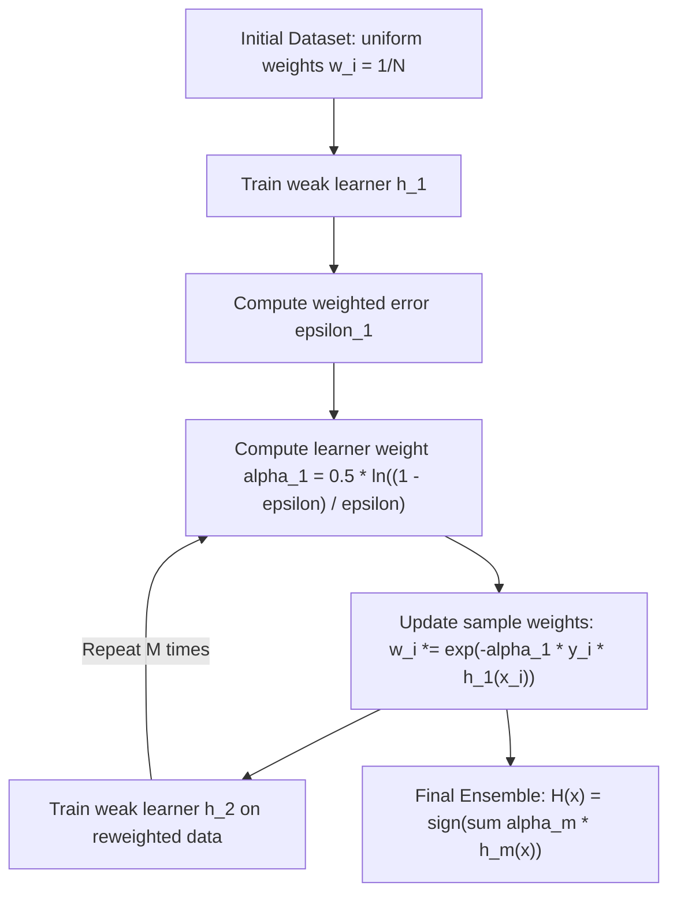

# The Boosting Idea

**Boosting** is a meta-algorithm for supervised learning based on a profound insight from computational learning theory: *can we convert a collection of weak learners — each only slightly better than random guessing — into a single, arbitrarily accurate strong learner?*

The answer, proven formally by Schapire (1990) and Freund & Schapire (1997), is **yes**. This discovery launched one of the most consequential algorithmic families in modern machine learning.

---

## 🧠 Weak-to-Strong Learning: The Core Idea

**Definition (Weak Learner):** A learning algorithm is *weak* if it produces a classifier $h: \mathcal{X} \to \{-1, +1\}$ whose error $\epsilon < 0.5$ on any weighted training distribution — that is, it is merely "slightly better than a coin flip."

**Definition (Strong Learner):** A learning algorithm is *strong* if it can produce a classifier with arbitrarily low training error (given sufficient data).

**Schapire's Theorem:** Any weak learner class can be boosted into a strong learner.

---

## ⚙️ From Weak to Strong: The Sequential Construction

The key mechanism of Boosting is **adaptive reweighting**:

### The Weight Update Rule
After training learner $h_m$ with weighted error $\epsilon_m$:

$$\alpha_m = \frac{1}{2} \ln\left(\frac{1 - \epsilon_m}{\epsilon_m}\right)$$

The sample weights are updated:

$$w_i^{(m+1)} = \frac{w_i^{(m)} \cdot \exp(-\alpha_m \cdot y_i \cdot h_m(x_i))}{Z_m}$$

where $Z_m$ is a normalization factor ensuring $\sum_i w_i^{(m+1)} = 1$.

**Intuition:**
- Points correctly classified by $h_m$ (`y_i * h_m(x_i) = +1`) → weights **decrease**
- Points misclassified by $h_m$ (`y_i * h_m(x_i) = -1`) → weights **increase**

Each subsequent learner is therefore forced to focus attention on the examples that proved hardest for all previous learners.

---

## 🔢 The Final Ensemble Prediction

After $M$ rounds, the final AdaBoost classifier is:

$$H(x) = \text{sign}\left(\sum_{m=1}^{M} \alpha_m \cdot h_m(x)\right)$$

Where $\alpha_m$ controls how much influence each learner has. A perfect learner ($\epsilon_m \approx 0$) gets a large positive $\alpha_m$; a random learner ($\epsilon_m \approx 0.5$) gets $\alpha_m \approx 0$; a consistently wrong learner ($\epsilon_m > 0.5$) gets a **negative** $\alpha_m$ (its prediction is flipped!).

---

## 🌉 From AdaBoost to Gradient Boosting

| Property | AdaBoost | Gradient Boosting |
|---|---|---|
| **Error Correction** | Reweight misclassified samples | Directly fit to **gradient of the loss** (pseudo-residuals) |
| **Loss Function** | Exponential loss $L = e^{-y F(x)}$ (implicit) | **Any differentiable** loss (MSE, Log-loss, Huber) |
| **Base Learner Update** | Multiplicative weight update on samples | Additive step in function space $F \leftarrow F + \nu h$ |
| **Connection** | AdaBoost minimizes exponential loss via gradient descent in function space | Explicit generalization of AdaBoost to arbitrary losses |

> [!TIP]
> Friedman (2001) showed that AdaBoost is a **special case** of Gradient Boosting where the loss function is the exponential loss $L(y, F) = e^{-y F(x)}$, and each step size $\alpha_m$ is set optimally. This insight unified and generalized the entire Boosting family under a single mathematical framework.

