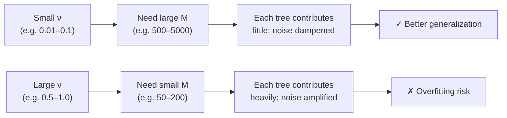
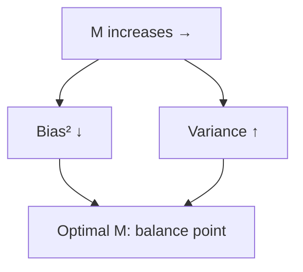
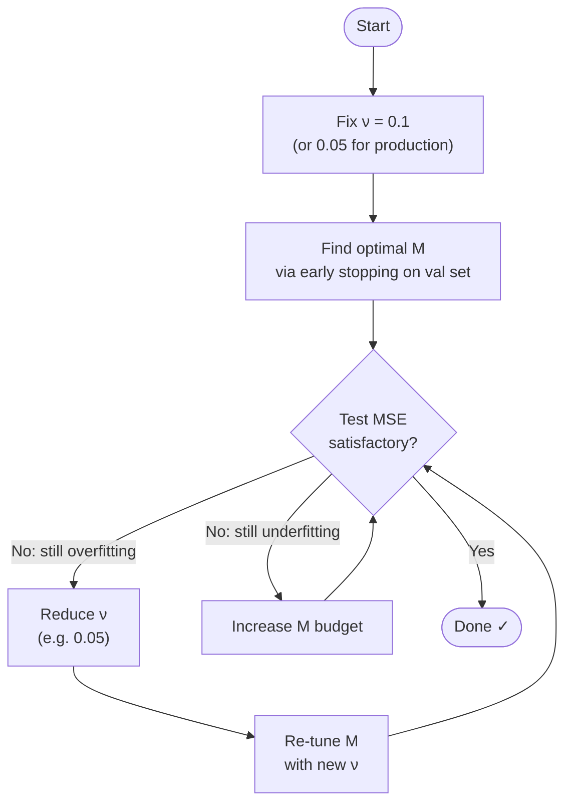

# Learning Rate and Number of Estimators in Gradient Boosting

## Overview

Two of the most critical hyperparameters in Gradient Boosting Machines (GBM) are:

- **Learning rate** ν (nu) — also called *shrinkage*
- **Number of estimators** M — the number of boosting rounds

They are deeply coupled: choosing one without considering the other leads to either underfitting or overfitting.

---

## 1. Learning Rate (Shrinkage) ν ∈ (0, 1]

### Update Rule

At each boosting round $m$, the ensemble prediction is updated as:

$$F_m(x) = F_{m-1}(x) + \nu \cdot h_m(x)$$

where:
- $F_{m-1}(x)$ is the ensemble prediction after $m-1$ rounds
- $h_m(x)$ is the weak learner (e.g., regression tree) fitted on the residuals
- $\nu \in (0, 1]$ is the learning rate (shrinkage parameter)

### Geometric Interpretation

Without shrinkage ($\nu = 1$), each new tree fully "steps" in the direction of steepest descent in function space. With $\nu < 1$, we take a **smaller step** — moving more cautiously in that direction:

```
Loss surface (function space):
                    ● F_{m-1}
                   /
   ν=1.0 →  ●  (big step, may overshoot)
            |
   ν=0.1 →  ● (small step, safer landing)
                    ↓
                optimal F*
```

This is exactly analogous to gradient descent in parameter space: a smaller step size trades speed for stability.

> [!NOTE]
> Shrinkage regularizes the model by limiting how much each tree can influence the final ensemble. It is one of the most effective regularization techniques in boosting.

### Why Small ν Helps Generalization

Each weak learner $h_m(x)$ is fitted on **noisy residuals** (residuals contain the irreducible noise in the data). A large $\nu$ amplifies this noise and memorizes it. A small $\nu$ dampens each tree's contribution, preventing the model from chasing noise too aggressively.

---

## 2. Number of Estimators M

The ensemble after $M$ rounds is:

$$F_M(x) = F_0 + \sum_{m=1}^{M} \nu \cdot h_m(x)$$

where $F_0 = \bar{y}$ (mean of training targets).

### Effect on Bias and Variance

| M (estimators) | Bias | Variance | Generalization |
|---|---|---|---|
| Very small (e.g. 5) | High | Low | Underfitting |
| Moderate | Medium | Medium | Good |
| Very large | Low | High | Overfitting risk |

As $M$ grows:
- **Bias** monotonically decreases — more trees fit the training data better
- **Variance** generally increases — more trees means the model is more sensitive to the specific training set

> [!IMPORTANT]
> Unlike random forests (where more trees are always safe), in gradient boosting **more estimators can lead to overfitting** — especially when ν is large.

---

## 3. The ν–M Trade-Off

The key insight, first described rigorously by **Friedman (2001)**, is:

> A smaller learning rate ν *requires* a larger M to achieve the same training accuracy, but the resulting model generalizes **better**.

### Friedman's Finding

$$\nu \leq 0.1 \text{ almost always gives the best generalization}$$

The intuition:



> [!TIP]
> In practice, **fix ν = 0.05 or 0.1** and tune M using early stopping on a validation set. This is far more efficient than grid-searching both simultaneously.

---

## 4. Bias–Variance Perspective

The generalization error can be decomposed as:

$$\text{Expected Error} = \text{Bias}^2 + \text{Variance} + \text{Irreducible Noise}$$

### Effect of M (fixed ν)



For a fixed ν:
- Early rounds (small M): **high bias** (underfitting), low variance
- Late rounds (large M): low bias, **high variance** (overfitting)
- Optimal M: the sweet spot minimized by cross-validation or early stopping

### Effect of ν (fixed M)

| ν | Bias | Variance | Comment |
|---|---|---|---|
| 1.0 | Low | **Very High** | Aggressive, overfits fast |
| 0.3 | Low-Medium | High | Often overfits |
| 0.1 | Medium | Medium | Good default |
| 0.05 | Medium-High | Low-Medium | Needs more M |
| 0.01 | High (unless M large) | Low | Very conservative |

> [!NOTE]
> The variance introduced by a large ν is **correlated** across the ensemble — unlike bagging, boosting trees are dependent, so high ν compounds errors across rounds.

---

## 5. Comparison Table: Typical (ν, M) Pairs

| Learning Rate ν | Estimators M | Train MSE | Test MSE | Use Case |
|---|---|---|---|---|
| 1.0 | 100 | Very Low | High | — Overfits |
| 0.3 | 100 | Low | Medium-High | Small datasets, quick iteration |
| 0.1 | 200 | Low | Low | **Default starting point** |
| 0.05 | 500 | Low | Low | Production models |
| 0.01 | 2000 | Low | Very Low | High-accuracy, slow training |
| 0.01 | 100 | High | High | — Underfits (not enough M) |

> [!WARNING]
> Never use ν = 1.0 without very strong regularization elsewhere (e.g., very shallow trees, subsampling). It is equivalent to full Newton steps and is highly unstable.

---

## 6. Practical Workflow



> [!IMPORTANT]
> Early stopping is the most reliable way to find optimal M. Use a held-out validation set and stop when validation loss stops improving for `n_iter_no_change` consecutive rounds (sklearn's default is 10).

---

## 7. Summary

| Concept | Key Takeaway |
|---|---|
| Learning rate ν | Shrinks each tree's contribution; smaller = more regularization |
| Estimators M | More trees = lower bias but higher variance |
| ν–M coupling | Small ν needs large M; this combination generalizes best |
| Friedman's rule | ν ≤ 0.1 almost always wins |
| Best practice | Fix ν, tune M with early stopping |

---

## References

- Friedman, J. H. (2001). *Greedy function approximation: a gradient boosting machine*. Annals of Statistics, 29(5), 1189–1232.
- Hastie, T., Tibshirani, R., & Friedman, J. (2009). *The Elements of Statistical Learning* (2nd ed.), Chapter 10.
- Chen, T., & Guestrin, C. (2016). *XGBoost: A scalable tree boosting system*. KDD 2016.
