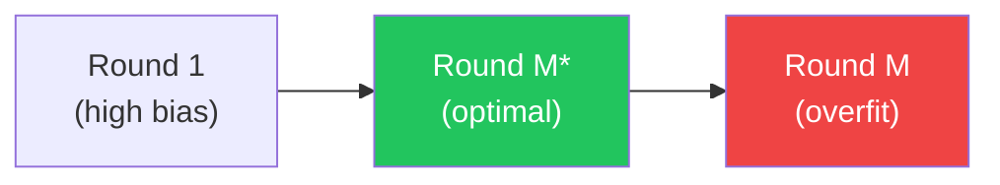
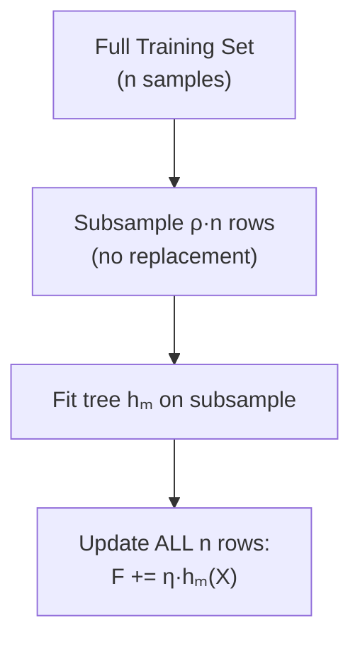
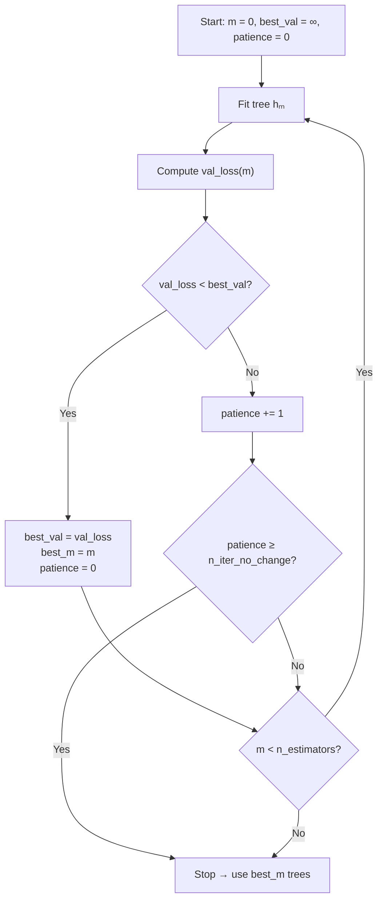

# Overfitting and Regularization in Gradient Boosting

## 1. Can Boosting Overfit?

**Yes — unlike Random Forest, Gradient Boosting can and does overfit.**

Random Forest achieves near-immunity to overfitting through **bagging** (bootstrap aggregating): each tree is trained on a random subset of the data *with replacement*, and predictions are averaged, which dramatically reduces variance. The ensemble cannot overfit in the classical sense because adding more trees stabilizes toward the law of large numbers.

Gradient Boosting, by contrast, is a **sequential residual-correction** algorithm. Each new tree is fit to the *residuals* of the ensemble so far, meaning the model keeps pushing harder and harder to fit the training signal — including noise.

### Train vs. Validation Loss Over Boosting Rounds

| Region | Train Loss | Val Loss | Description |
|---|---|---|---|
| Rounds 1 … M\* | ↓ decreasing | ↓ decreasing | Bias reduction dominates |
| Round M\* | ↓ still falling | **minimum** | Sweet spot |
| Rounds M\*+1 … M | ↓ still falling | ↑ rising | Variance increasing, noise memorised |

The key insight:

$$\text{MSE}_{\text{val}}(M) = \underbrace{\text{Bias}^2(M)}_{\downarrow \text{ as } M \uparrow} + \underbrace{\text{Variance}(M)}_{\uparrow \text{ as } M \uparrow} + \sigma^2_\epsilon$$

After the optimal round $M^*$, variance growth outpaces bias reduction.

---

## 2. Regularization Tools

### 2.1 Learning Rate (Shrinkage) — `learning_rate` η

Each tree's prediction is **shrunk** before being added to the ensemble:

$$F_m(x) = F_{m-1}(x) + \eta \cdot h_m(x)$$

where $0 < \eta \leq 1$.

- **Small η** → smaller update steps → more trees needed → better generalization
- **Large η** → aggressive updates → risk of overshooting the optimal and memorising noise
- **Rule of thumb**: use `learning_rate ≤ 0.1` and increase `n_estimators` to compensate

> [!TIP]
> The classic prescription is *"shrink and stump"*: use `learning_rate=0.05–0.1` with shallow trees and many rounds, then apply early stopping.

### 2.2 Tree Depth — `max_depth`

Controls the **complexity of each base learner**. Deeper trees capture higher-order interactions between features.

| `max_depth` | Interactions modelled | Typical use |
|---|---|---|
| 1 (stump) | Main effects only | Additive models, interpretable |
| 2–3 | Two- / three-way interactions | **Recommended default** |
| 4–6 | Higher-order | Large tabular data, careful tuning |
| > 6 | Very high | Usually overfits without other regularization |

> [!NOTE]
> GBM is less sensitive to tree depth than Random Forest because shrinkage already limits each tree's contribution. `max_depth=3` is an excellent default.

### 2.3 Minimum Samples per Leaf — `min_samples_leaf`

Prevents splits that produce tiny, noisy leaf nodes.

$$\text{MSE}_{\text{leaf}} \approx \sigma^2_\epsilon / n_{\text{leaf}}$$

Small leaves have high variance. Requiring `min_samples_leaf ≥ 10–20` forces the tree to only make splits that are supported by enough data.

### 2.4 Subsample — Stochastic GBM

Introduced by Friedman (2002). Each tree is fit on a **random fraction** of the training data (chosen *without replacement*):

$$\text{subsample} = \rho \in (0, 1]$$

**Why it helps:**
- Introduces randomness similar to bagging → reduces variance
- Each tree sees slightly different data → reduces correlation between trees
- Faster training (fewer rows per tree)
- Often improves generalisation even relative to full-batch GBM

> [!IMPORTANT]
> Unlike Random Forest's bootstrap (with replacement), `subsample` in GBM is **without replacement** (a random subsample). Typical values: `0.5–0.8`.

### 2.5 Max Features — `max_features`

Random feature selection **per split** (similar to Random Forest's column subsampling).

- At each split candidate, only a random subset of features are considered
- Reduces correlation between trees
- Controls per-split complexity independently of `max_depth`

Typical values: `sqrt(n_features)` or `0.5–0.8` as a fraction.

---

## 3. Early Stopping

The simplest and most powerful regularization: **stop adding trees when the validation loss stops improving**.

### Algorithm

**sklearn parameters:**
- `validation_fraction` — fraction of training data held out as validation
- `n_iter_no_change` — number of rounds without improvement before stopping
- `tol` — minimum improvement threshold

> [!WARNING]
> Early stopping requires a held-out **validation set** that is never used for tree fitting. If you use the training set for early stopping, you are evaluating on what the model already memorised — this will not detect overfitting.

---

## 4. Regularization Comparison Table

| Tool | What it Controls | Effect on Bias | Effect on Variance | Typical Default |
|---|---|---|---|---|
| `learning_rate` η | Step size per tree | ↑ slight (needs more trees) | ↓↓ strong | 0.05–0.1 |
| `n_estimators` M | Number of trees | ↓ as M ↑ | ↑ as M ↑ | 100–500 (+ early stop) |
| `max_depth` | Tree complexity | ↑ if too shallow | ↓ as depth ↓ | 3 |
| `min_samples_leaf` | Leaf node size | ↑ if too large | ↓ | 10–20 |
| `subsample` ρ | Fraction of rows per tree | negligible | ↓↓ | 0.5–0.8 |
| `max_features` | Fraction of cols per split | negligible | ↓ | 0.5–1.0 |
| Early stopping | Optimal M\* | ↑ slight (stops early) | ↓↓ | n\_iter\_no\_change=10 |

> [!NOTE]
> **Bias-variance rule of thumb**: if your model underfits (high train loss), reduce regularization (increase depth, lr, n_estimators). If it overfits (val loss > train loss), add regularization (shrink lr, add subsample, reduce depth, early stop).

---

## 5. Key Mathematical Summary

The regularized GBM update rule with subsample:

$$F_m(x) = F_{m-1}(x) + \eta \cdot h_m(x; \tilde{\mathcal{D}}_m)$$

where $\tilde{\mathcal{D}}_m \subset \mathcal{D}_{\text{train}}$, $|\tilde{\mathcal{D}}_m| = \lfloor \rho \cdot n \rfloor$, sampled without replacement.

The objective at each step (MSE case):

$$h_m = \arg\min_h \sum_{i \in \tilde{\mathcal{D}}_m} \left( r_i^{(m)} - h(x_i) \right)^2, \quad r_i^{(m)} = y_i - F_{m-1}(x_i)$$

> [!CAUTION]
> Combining **high `learning_rate`** with **deep trees** and **no early stopping** is the most common cause of severe overfitting in GBM. Always pair a large `n_estimators` with early stopping or use a small `learning_rate`.

---

## 6. Practice

See [`practice.py`](./practice.py) for a full demonstration using a from-scratch GBM:

- Overfitting curve visualisation (train vs val MSE over 500 rounds)
- Subsample comparison (full batch vs stochastic)
- Learning rate comparison
- sklearn `GradientBoostingRegressor` cross-check

---

## References

- Friedman, J.H. (2001). *Greedy function approximation: a gradient boosting machine*. Annals of Statistics.
- Friedman, J.H. (2002). *Stochastic gradient boosting*. Computational Statistics & Data Analysis.
- Hastie, Tibshirani & Friedman. *The Elements of Statistical Learning*, Ch. 10.
