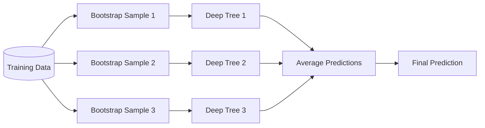
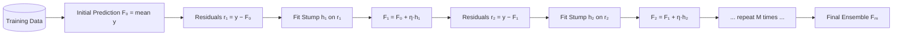

# Random Forest vs Gradient Boosting

A deep-dive comparison of two ensemble powerhouses — when to use each, how they differ mathematically, and practical guidance.

---

## 1. Core Conceptual Difference

| Property | Random Forest (RF) | Gradient Boosting (GBM) |
|---|---|---|
| **Combination strategy** | Parallel (independent trees) | Sequential (each tree corrects the previous) |
| **Error reduced** | **Variance** | **Bias** |
| **Base learner type** | Deep trees (high variance, low bias) | Stumps / shallow trees (low variance, higher bias) |
| **Overfitting mechanism** | Averages out variance across diverse trees | Accumulates corrections → can overfit if too many rounds |
| **Training dependency** | Trees are independent | Each tree depends on the residuals of all prior trees |

### Why RF reduces Variance

Each tree is trained on a **bootstrap sample** (random rows) with **random feature subsets**. Each individual tree overfits its bootstrap sample, but averaging $M$ independent, identically distributed estimators with variance $\sigma^2$ gives:

$$\text{Var}\!\left(\bar{f}\right) = \frac{\sigma^2}{M}$$

In practice the trees are correlated (correlation $\rho$), so:

$$\text{Var}\!\left(\bar{f}\right) = \rho\sigma^2 + \frac{1-\rho}{M}\sigma^2$$

Randomisation (feature subsampling) reduces $\rho$, which reduces variance.

### Why GBM reduces Bias

GBM fits each new tree $h_m$ to the **negative gradient** (residuals for MSE loss) of the current ensemble $F_{m-1}$:

$$F_m(x) = F_{m-1}(x) + \eta \cdot h_m(x)$$

where $\eta$ is the learning rate. The ensemble progressively corrects its own systematic errors, driving bias toward zero.

---

## 2. Formal Bias–Variance Decomposition

For MSE loss, the expected error decomposes as:

$$\mathbb{E}\!\left[(y - \hat{f}(x))^2\right] = \underbrace{\text{Bias}^2[\hat{f}(x)]}_{\text{systematic error}} + \underbrace{\text{Var}[\hat{f}(x)]}_{\text{sensitivity to data}} + \underbrace{\sigma^2_\varepsilon}_{\text{irreducible noise}}$$

| Component | Random Forest | Gradient Boosting |
|---|---|---|
| **Bias²** | Moderate (deep trees have low bias individually; averaging does not reduce bias) | Low (sequential boosting reduces bias each round) |
| **Variance** | **Low** (averaging $M$ trees) | Moderate–High (learning rate + depth control needed) |
| **Noise floor** | Absorbs noise gracefully (outlier trees are averaged away) | Noisy residuals propagate; outliers can dominate gradients |

> [!NOTE]
> Both methods push the **total error** down, but through opposite levers. RF attacks variance; GBM attacks bias. On clean, structured data GBM often wins because bias is the bottleneck. On noisy data RF wins because variance (and noise amplification) is the bottleneck.

---

## 3. When to Use Which

| Situation | Recommended | Reason |
|---|---|---|
| **Noisy / outlier-heavy data** | ✅ Random Forest | Averaging dilutes the effect of noisy samples |
| **Clean tabular data, top performance needed** | ✅ GBM (XGBoost / LightGBM) | Lower bias, usually wins Kaggle-style benchmarks |
| **Need fast training** | ✅ Random Forest | Trees built in parallel (`n_jobs=-1`); GBM is inherently sequential |
| **Need interpretability** | ✅ Random Forest | Feature importance is straightforward; no interaction between trees |
| **Small dataset** | ✅ Random Forest | Bootstrapping + averaging is more stable; GBM can overfit |
| **Many hyperparameters to tune** | ✅ Random Forest | Fewer critical knobs (`n_estimators`, `max_features`) |
| **Overfitting risk** | ✅ Random Forest | Minimal; GBM requires careful tuning of `learning_rate` + `n_estimators` |

> [!TIP]
> A common practical rule: **start with Random Forest** as a strong baseline, then try **LightGBM/XGBoost** when you need that extra 1–3% performance on clean, well-preprocessed data.

> [!CAUTION]
> GBM with a high learning rate and many estimators **will overfit** on small or noisy datasets. Always use early stopping or cross-validation when tuning GBM.

---

## 4. Training Process Comparison

### Random Forest — Parallel



### Gradient Boosting — Sequential



---

## 5. Hyperparameter Comparison

| Hyperparameter | Random Forest | Gradient Boosting | Notes |
|---|---|---|---|
| `n_estimators` | 100–500 (more = safer) | 100–1000 (tune with early stopping) | RF plateaus; GBM can overfit |
| `max_depth` | None (unlimited) | 3–6 (shallow!) | Shallow trees = low-variance base learners |
| `learning_rate` | N/A | 0.01–0.3 | Lower = better generalisation, needs more estimators |
| `max_features` | `sqrt(p)` or `log2(p)` | N/A (use `subsample` instead) | Decorrelates RF trees |
| `subsample` | N/A (bootstrap = 1.0) | 0.5–0.8 | Stochastic GBM, reduces overfitting |
| `min_samples_leaf` | 1–4 | 1–20 | Regularises leaf purity |
| `n_jobs` | `-1` (fully parallel) | 1 (sequential by nature) | RF scales linearly with cores |

> [!IMPORTANT]
> For GBM, **learning rate and n_estimators are coupled**: halving the learning rate requires doubling the number of trees to maintain the same bias. Use early stopping (e.g. `sklearn` `n_iter_no_change`) to find the right balance automatically.

> [!WARNING]
> Default `max_depth=None` in `RandomForestRegressor` gives fully grown trees — appropriate for RF (variance is controlled by averaging), but **never** use unlimited depth in GBM.

---

## 6. Quick Reference

```
Random Forest:
  - Parallel, independent trees
  - Bootstrap + random feature subsets
  - Reduces VARIANCE
  - Robust to noise, fast (parallelisable)
  - Use: noisy data, quick baseline, interpretability

Gradient Boosting:
  - Sequential, additive residual fitting
  - Shallow trees (stumps)
  - Reduces BIAS
  - High accuracy on clean data, sensitive to noise
  - Use: clean tabular data, competition-grade accuracy
```

---

## References

- Breiman, L. (2001). *Random Forests*. Machine Learning, 45, 5–32.
- Friedman, J. H. (2001). *Greedy Function Approximation: A Gradient Boosting Machine*. Annals of Statistics, 29(5), 1189–1232.
- Hastie, T., Tibshirani, R., & Friedman, J. (2009). *The Elements of Statistical Learning* (2nd ed.). Springer.
