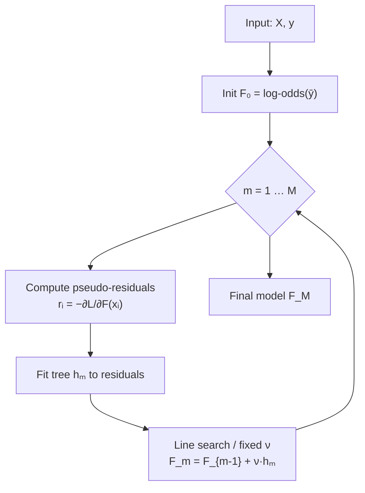
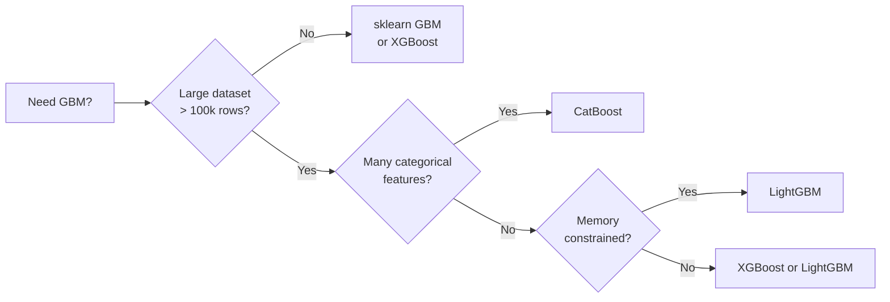

# Gradient Boosting Machines — scikit-learn API & Modern Variants

> [!NOTE]
> This module covers scikit-learn's `GradientBoostingClassifier` / `GradientBoostingRegressor`, their key hyperparameters, modern high-performance variants (XGBoost, LightGBM, CatBoost), and practical tuning strategies.

---

## 1. The Gradient Boosting Algorithm (Recap)

Each stage fits a tree to the **negative gradient** of the loss:

$$F_m(x) = F_{m-1}(x) + \nu \cdot h_m(x)$$

where $\nu$ is the **learning rate** and $h_m$ is the $m$-th weak learner. For log-loss (binary classification):

$$\tilde{y}_i = y_i - \sigma(F_{m-1}(x_i)), \quad \sigma(z) = \frac{1}{1+e^{-z}}$$



---

## 2. `GradientBoostingClassifier` / `GradientBoostingRegressor` API

```python
from sklearn.ensemble import GradientBoostingClassifier, GradientBoostingRegressor

clf = GradientBoostingClassifier(
    n_estimators=100,
    learning_rate=0.1,
    max_depth=3,
    subsample=1.0,
    min_samples_leaf=1,
    max_features=None,
    n_iter_no_change=None,
    validation_fraction=0.1,
    random_state=42,
)
```

### Key Parameters

| Parameter | Default | Description |
|---|---|---|
| `n_estimators` | `100` | Number of boosting stages (trees). More trees → lower bias, risk of overfitting without early stopping. |
| `learning_rate` | `0.1` | Shrinkage factor $\nu \in (0, 1]$. Smaller values need more trees but generalise better. Interacts with `n_estimators`. |
| `max_depth` | `3` | Maximum depth of each individual tree. Deeper trees capture higher-order interactions but overfit faster. |
| `subsample` | `1.0` | Fraction of training samples drawn (without replacement) per stage. `subsample < 1.0` → **stochastic GBM** — reduces variance, allows larger `learning_rate`. |
| `min_samples_leaf` | `1` | Minimum number of samples required at a leaf node. Increasing this acts as regularisation. |
| `max_features` | `None` | Features to consider at each split (`int`, `float`, `"sqrt"`, `"log2"`, or `None` = all). Column-subsampling similar to XGBoost's `colsample_bytree`. |
| `n_iter_no_change` | `None` | If set, enables **built-in early stopping**: training stops when the validation score has not improved for this many rounds. |
| `validation_fraction` | `0.1` | Proportion of training data to use as validation when `n_iter_no_change` is set. |

> [!TIP]
> The classic rule of thumb: **lower `learning_rate` + higher `n_estimators`** usually wins. Start with `learning_rate=0.05` and tune `n_estimators` via early stopping.

> [!IMPORTANT]
> For the **regressor**, the default loss is `"squared_error"`. For the **classifier**, it uses `"log_loss"` (binary or multi-class deviance). Both expose the same hyperparameter surface.

---

## 3. `staged_predict` — Learning Curves

`staged_predict` / `staged_predict_proba` yield predictions at each boosting stage without refitting:

```python
from sklearn.metrics import accuracy_score

clf.fit(X_train, y_train)

stages = []
for i, y_pred in enumerate(clf.staged_predict(X_test), start=1):
    stages.append((i, accuracy_score(y_test, y_pred)))

# Plot accuracy vs. number of estimators
import matplotlib.pyplot as plt
ns, accs = zip(*stages)
plt.plot(ns, accs)
plt.xlabel("n_estimators"); plt.ylabel("Test accuracy")
plt.title("Learning curve via staged_predict")
```

This is useful for:
- Identifying the **optimal number of trees** post-hoc.
- Diagnosing **overfitting** (accuracy peaks then declines).

---

## 4. Modern GBM Variants — Comparison

| Feature | **sklearn GBM** | **XGBoost** | **LightGBM** | **CatBoost** |
|---|---|---|---|---|
| **Algorithm** | Friedman's original | Regularised boosting | Gradient-based one-side sampling (GOSS) | Ordered boosting |
| **Tree growth** | Depth-wise (level-wise) | Depth-wise | **Leaf-wise** (best-first) | Symmetric (oblivious) trees |
| **Speed on large data** | Slow | Fast | **Fastest** | Fast |
| **Categoricals** | Manual encoding needed | Manual encoding needed | Native (integer encoding) | **Native (target statistics)** |
| **L1/L2 regularisation** | ✗ (implicit via tree depth) | `reg_alpha` (L1), `reg_lambda` (L2) | `reg_alpha`, `reg_lambda` | `l2_leaf_reg` |
| **Column subsampling** | `max_features` | `colsample_bytree`, `colsample_bylevel` | `feature_fraction` | `rsm` |
| **Row subsampling** | `subsample` | `subsample` | `bagging_fraction` + `bagging_freq` | `subsample` |
| **Early stopping** | `n_iter_no_change` | `early_stopping_rounds` | `early_stopping_rounds` | `early_stopping_rounds` |
| **GPU support** | ✗ | ✓ | ✓ | ✓ |
| **Install** | `pip install scikit-learn` | `pip install xgboost` | `pip install lightgbm` | `pip install catboost` |

### Why choose each?



---

## 5. Hyperparameter Tuning — Typical Grid Search Ranges

```python
from sklearn.model_selection import GridSearchCV

param_grid = {
    "n_estimators":   [100, 200, 500],
    "learning_rate":  [0.01, 0.05, 0.1, 0.3],
    "max_depth":      [2, 3, 5],
    "subsample":      [0.7, 0.8, 1.0],
    "min_samples_leaf": [1, 5, 10],
    "max_features":   ["sqrt", "log2", None],
}

gs = GridSearchCV(
    GradientBoostingClassifier(random_state=42),
    param_grid,
    cv=5,
    scoring="roc_auc",
    n_jobs=-1,
)
gs.fit(X_train, y_train)
print(gs.best_params_)
```

### Practical Tuning Strategy

1. **Fix `learning_rate=0.1`**, tune `n_estimators` with early stopping.
2. **Tune tree structure**: `max_depth` (2–5), `min_samples_leaf`.
3. **Add stochasticity**: `subsample` (0.7–0.9), `max_features` ("sqrt").
4. **Lower `learning_rate`** to 0.01–0.05, re-tune `n_estimators` upward.

> [!WARNING]
> The **learning rate × n_estimators trade-off** is the most critical axis. Halving `learning_rate` typically requires doubling `n_estimators` to maintain the same training loss.

> [!CAUTION]
> With `max_depth >= 5` and `subsample=1.0`, sklearn GBM can overfit rapidly on small datasets (< 1 000 rows). Always use cross-validation.

---

## 6. Quick Reference — Loss Functions

| Task | Loss | Gradient |
|---|---|---|
| Binary classification | Log-loss (deviance) | $y_i - \sigma(F)$ |
| Multi-class | Multi-class deviance | Softmax residuals |
| Regression | Squared error | $y_i - F(x_i)$ |
| Regression (robust) | Absolute error / Huber | Clipped residuals |

$$\text{Log-loss} = -\frac{1}{n}\sum_{i=1}^{n}\left[y_i \log \hat{p}_i + (1-y_i)\log(1-\hat{p}_i)\right]$$

---

## References

- [scikit-learn GBM User Guide](https://scikit-learn.org/stable/modules/ensemble.html#gradient-tree-boosting)
- Friedman, J. H. (2001). *Greedy function approximation: A gradient boosting machine.* Annals of Statistics.
- Chen & Guestrin (2016). *XGBoost: A Scalable Tree Boosting System.* KDD.
- Ke et al. (2017). *LightGBM: A Highly Efficient Gradient Boosting Decision Tree.* NeurIPS.
- Prokhorenkova et al. (2018). *CatBoost: unbiased boosting with categorical features.* NeurIPS.
