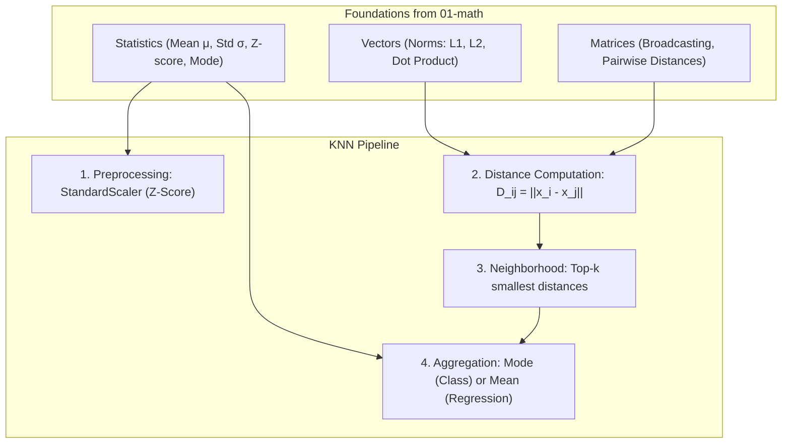

# K-Nearest Neighbors (KNN)

**K-Nearest Neighbors (KNN)** is a non-parametric, instance-based supervised learning algorithm used for both **classification** and **regression**. Instead of fitting mathematical equations with learnable weights ($\mathbf{w}, b$), KNN makes predictions by memorizing the training data and finding the $k$ closest neighbors in feature space.

This folder contains practice exercises and conceptual notes covering KNN from first principles: the mechanics of lazy learning, distance metrics, selecting $k$ and the bias-variance tradeoff, the critical role of feature scaling, StandardScaler implementation, classification vs regression aggregation, and unified estimators written in pure NumPy.

Each subfolder has:
- `README.md` — theory, intuition, mathematical formulas, and examples
- `practice.py` — hands-on Python exercises implemented from first principles with NumPy

---

## 🗺️ Roadmap & Modules

| # | Submodule | Core Concept | Why it matters in ML |
|---|---|---|---|
| 1 | **[How KNN Works](how-knn-works/README.md)** | Lazy learning & non-parametric memory | Understanding instance-based learning, zero training cost vs inference complexity $O(m \cdot n \cdot d)$. |
| 2 | **[Distance Metrics](distance-metrics/README.md)** | Euclidean ($L_2$), Manhattan ($L_1$), Minkowski ($L_p$), Cosine | Defining geometric closeness and vectorizing pairwise distance matrix computations. |
| 3 | **[Choosing k](choosing-k/README.md)** | Bias-Variance tradeoff & voting ties | Balancing overfitting ($k=1$, jagged boundary) vs underfitting (large $k$, majority vote everywhere). |
| 4 | **[Feature Scaling](feature-scaling/README.md)** | Distance sensitivity & scale distortion | Why unscaled large-magnitude features drown out smaller informative features and break neighborhood search. |
| 5 | **[StandardScaler](standard-scaler/README.md)** | Z-score normalization $z = \frac{x-\mu}{\sigma}$ | Building a leak-free feature scaler from scratch, zero-variance protection, and inverse transforms. |
| 6 | **[Classification & Regression](classification-and-regression/README.md)** | Mode voting vs Local continuous averaging | Predicting discrete labels and class probabilities vs continuous numerical targets and distance weighting. |
| 7 | **[From Scratch](from-scratch/README.md)** | Complete NumPy implementation | Full object-oriented `KNNClassifier` and `KNNRegressor` matching scikit-learn's API and output. |

---

## 📂 Directory Structure

```
knn/
├── how-knn-works               # Lazy learning, neighborhood intuition, algorithm steps
├── distance-metrics            # Euclidean, Manhattan, Minkowski, Cosine, vectorized pairwise distances
├── choosing-k                  # Hyperparameter k, bias-variance tradeoff, validation curve
├── feature-scaling             # Why distance models fail without scaling, geometric distortion
├── standard-scaler             # Z-score standardization from scratch, data leakage prevention
├── classification-and-regression # Majority voting vs mean / distance-weighted regression
└── from-scratch                # Full NumPy KNNClassifier and KNNRegressor classes
```

---

## 🔗 How Math Connects to K-Nearest Neighbors



1. **Vectors (`01-math/vectors`)**: Vector norms ($L_1$ and $L_2$) define the distance between points; dot products enable fast cosine and Euclidean computations.
2. **Matrices (`01-math/matrix`)**: Pairwise distance matrices $\mathbf{D} \in \mathbb{R}^{m \times n}$ leverage matrix broadcasting and outer products to replace slow loops.
3. **Statistics (`01-math/statistics`)**: Mean $\mu$ and standard deviation $\sigma$ power `StandardScaler`, while majority vote (statistical mode) and sample mean drive neighbor target aggregation.

---

## 🧭 Learning Path

Work through the submodules in numbered order:
1. Start with **[How KNN Works](how-knn-works/README.md)** to grasp lazy learning.
2. Study **[Distance Metrics](distance-metrics/README.md)** to understand how similarity is quantified geometrically.
3. Learn the bias-variance curve in **[Choosing k](choosing-k/README.md)**.
4. Witness why unscaled features fail in **[Feature Scaling](feature-scaling/README.md)** and build **[StandardScaler](standard-scaler/README.md)**.
5. Compare classification vs regression mechanics in **[Classification & Regression](classification-and-regression/README.md)**.
6. Assemble the complete pipeline in **[From Scratch](from-scratch/README.md)** and compare it directly with scikit-learn.

