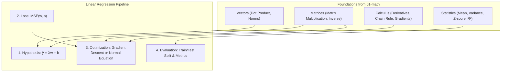

# Linear Regression

**Linear Regression** is the foundational supervised learning algorithm for predicting continuous numerical values. It models the relationship between input features and target values by fitting a linear equation to observed data.

This folder contains practice exercises and notes covering Linear Regression from first principles—starting from the single-variable hypothesis up through calculus-based gradient descent, NumPy vectorization, the analytical Normal Equation, train/test validation, and regularization.

Each subfolder has:
- `README.md` — theory, intuition, mathematical formulas, and examples
- `practice.py` — hands-on Python exercises implemented from scratch without high-level black-box estimators

---

## 🗺️ Roadmap & Modules

| # | Submodule | Core Concept | Why it matters in ML |
|---|---|---|---|
| 1 | **[Hypothesis](hypothesis/README.md)** | $\hat{y} = wx + b$ | The forward pass: understanding slopes, weights, intercepts, and linear predictions. |
| 2 | **[Loss Function](loss-function/README.md)** | $\text{MSE} = \frac{1}{n} \sum (y - \hat{y})^2$ | Quantifying error, understanding the convex parabolic loss landscape, and why squaring errors matters. |
| 3 | **[Gradient Descent](gradient-descent/README.md)** | $w \leftarrow w - \alpha \frac{\partial J}{\partial w}$ | Optimization from scratch using calculus partial derivatives, learning rates, and convergence. |
| 4 | **[Vectorization](vectorization/README.md)** | NumPy SIMD acceleration | Replacing slow Python loops with array operations, achieving 80x+ speedups. |
| 5 | **[Multiple Linear Regression](multiple-linear-regression/README.md)** | $\hat{\mathbf{y}} = \mathbf{X}\mathbf{w} + b$ | Scaling to multiple features, multivariate gradients, and Z-score standardization. |
| 6 | **[Normal Equation](normal-equation/README.md)** | $\boldsymbol{\theta} = (\mathbf{X}^T\mathbf{X})^{-1}\mathbf{X}^T\mathbf{y}$ | The exact analytical closed-form solution to Ordinary Least Squares (OLS) via linear algebra. |
| 7 | **[Train/Test Split](train-test-split/README.md)** | Generalization & $R^2$ Score | Preventing memorization/overfitting, measuring out-of-sample performance, and metrics (RMSE, MAE, $R^2$). |
| 8 | **[Regularization](regularization/README.md)** | Ridge ($L_2$) & Lasso ($L_1$) | Penalizing large weights, handling multicollinearity, and preventing overfitting. |

---

## 📂 Directory Structure

```
linear-regression/
├── hypothesis                  # Forward pass: ŷ = wx + b, weights and bias
├── loss-function               # Mean Squared Error (MSE), residuals, loss surface
├── gradient-descent            # Optimization: partial derivatives, learning rate, updates
├── vectorization               # NumPy vectorized operations & parallel SIMD speedup
├── multiple-linear-regression  # Multivariate models & feature standardization
├── normal-equation             # Analytical solution: θ = (X^T X)^(-1) X^T y
├── train-test-split            # Generalization, underfitting/overfitting, R² metric
└── regularization              # Ridge (L2) & Lasso (L1) penalty, weight shrinkage
```

---

## 🔗 How Math Connects to Linear Regression

Linear Regression directly integrates all the foundational concepts built in `01-math`:



1. **Vectors (`01-math/vectors`)**: Single sample features and weights form vectors; prediction is a dot product $\mathbf{w} \cdot \mathbf{x} + b$.
2. **Matrices (`01-math/matrix`)**: Entire datasets are feature matrices $\mathbf{X} \in \mathbb{R}^{n \times d}$. The analytical Normal Equation requires matrix transpose and inverse $(\mathbf{X}^T\mathbf{X})^{-1}\mathbf{X}^T\mathbf{y}$.
3. **Calculus (`01-math/calculus`)**: Computing the gradients $\frac{\partial J}{\partial w}$ and $\frac{\partial J}{\partial b}$ uses the power rule and chain rule to drive gradient descent downhill.
4. **Statistics (`01-math/statistics`)**: $Z$-score feature standardization centers and scales input dimensions, while $R^2$ measures explained variance.
