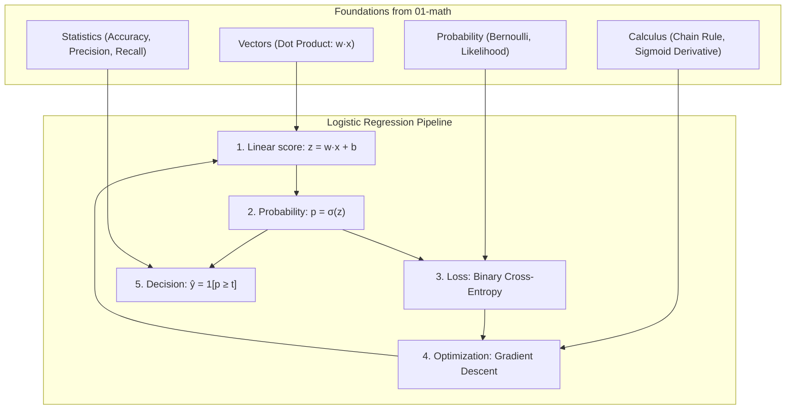

# Logistic Regression

**Logistic Regression** is the foundational supervised learning algorithm for **binary classification**. Instead of predicting a continuous value, it estimates the probability that an input belongs to class 1, by passing a linear score through the sigmoid function.

This folder contains practice exercises and notes covering logistic regression from first principles: why linear regression fails for classes, the sigmoid, probabilities and decision thresholds, the decision boundary, the Binary Cross-Entropy loss, gradient descent for classification, a full NumPy implementation, and the scikit-learn equivalent.

Each subfolder has:
- `README.md` — theory, intuition, mathematical formulas, and examples
- `practice.py` — hands-on Python exercises; the from-scratch modules use only NumPy

---

## 🗺️ Roadmap & Modules

| # | Submodule | Core Concept | Why it matters in ML |
|---|---|---|---|
| 1 | **[Classification](classification/README.md)** | Discrete $y \in \{0, 1\}$ and $P(y \mid \mathbf{x})$ | Why linear regression on labels fails and what a classifier must output. |
| 2 | **[Sigmoid](sigmoid/README.md)** | $\sigma(z) = \frac{1}{1 + e^{-z}}$ | Squashes any score into $(0, 1)$; its derivative $\sigma(1-\sigma)$ drives all gradients. |
| 3 | **[Probability & Decision Threshold](probability-and-threshold/README.md)** | $\hat{y} = \mathbb{1}[p \geq t]$ | Converts probabilities into labels and trades precision against recall. |
| 4 | **[Decision Boundary](decision-boundary/README.md)** | $\mathbf{w}^\top\mathbf{x} + b = 0$ | Geometry of the classifier: a hyperplane that separates the classes. |
| 5 | **[Binary Cross-Entropy](binary-cross-entropy/README.md)** | $-[y\log p + (1-y)\log(1-p)]$ | The loss for classification, equal to maximum likelihood under a Bernoulli model. |
| 6 | **[Gradient Descent](gradient-descent/README.md)** | $\nabla_{\mathbf{w}} J = \frac{1}{n}\mathbf{X}^\top(\mathbf{p} - \mathbf{y})$ | Deriving and applying the classification gradient, with a finite-difference check. |
| 7 | **[From Scratch](from-scratch/README.md)** | Complete NumPy implementation | Putting the whole pipeline together: standardization, training loop, evaluation. |
| 8 | **[scikit-learn](scikit-learn/README.md)** | `LogisticRegression`, `Pipeline`, `C` | The production API, regularization strength, and metrics such as `log_loss`. |

---

## 📂 Directory Structure

```
logistic-regression/
├── classification              # Binary labels, why linear regression is not enough
├── sigmoid                     # Sigmoid function, key values, derivative, stability
├── probability-and-threshold   # P(y=1|x), decision threshold, precision vs recall
├── decision-boundary           # Linear separating hyperplane, geometry of w and b
├── binary-cross-entropy        # Log loss, maximum likelihood, confident-error penalty
├── gradient-descent            # Derivation of ∂J/∂w and ∂J/∂b, update rule
├── from-scratch                # Full NumPy logistic regression class
└── scikit-learn                # LogisticRegression API, pipelines, regularization C
```

---

## 🔗 How Math Connects to Logistic Regression



1. **Vectors (`01-math/vectors`)**: the linear score $z = \mathbf{w}^\top\mathbf{x} + b$ is a dot product.
2. **Probability (`01-math/probability`)**: the sigmoid models $P(y=1 \mid \mathbf{x})$, and BCE is the Bernoulli negative log-likelihood.
3. **Calculus (`01-math/calculus`)**: the chain rule combined with $\sigma'(z) = \sigma(z)(1-\sigma(z))$ gives the clean gradient $p - y$.
4. **Statistics (`01-math/statistics`)**: accuracy, precision, and recall evaluate the thresholded decisions.

---

## 🧭 Learning Path

Work through the submodules in order: each one builds on the previous. `from-scratch` brings the pieces together, and `scikit-learn` shows that the library produces the same model.
