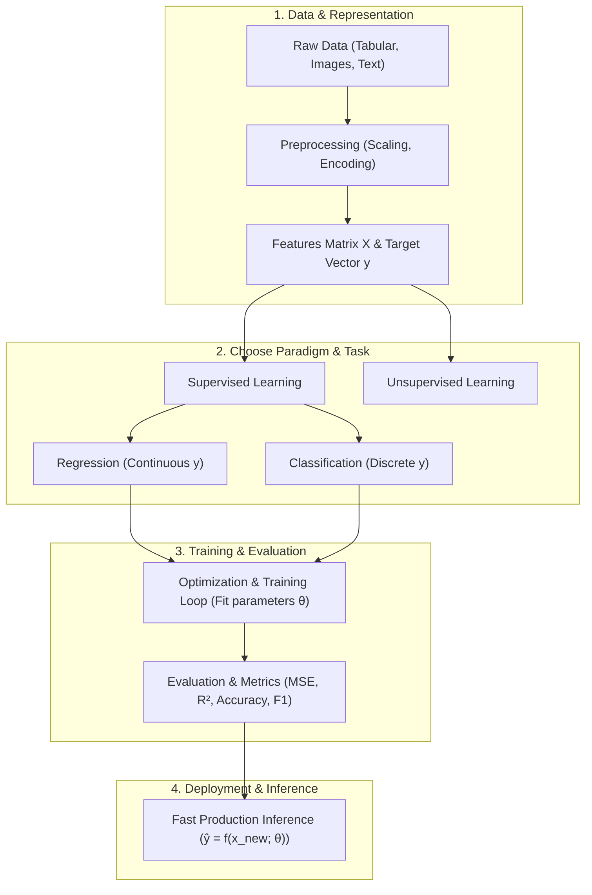

# Machine Learning Foundations

**Machine Learning Foundations** covers the core principles, paradigms, workflows, and terminology of Artificial Intelligence and Machine Learning. 

Before diving into specific mathematical algorithms like Linear Regression, Logistic Regression, or Neural Networks, these concepts establish how computers learn from data, how data is structured, and how end-to-end ML pipelines operate.

This folder contains practice exercises and conceptual notes covering the foundational topics from scratch.

Each subfolder has:
- `README.md` — theory, intuition, mathematical definitions, and visual examples
- `practice.py` — hands-on Python exercises implemented from first principles

---

## 🗺️ Roadmap & Modules

| # | Submodule | Core Focus | Why it matters in ML |
|---|---|---|---|
| 1 | **[What is ML](what-is-ml/README.md)** | Traditional code vs Learning from data | The core paradigm shift: Data + Labels $\to$ Model, Samuel & Mitchell definitions. |
| 2 | **[Learning Paradigms](learning-paradigms/README.md)** | Supervised vs Unsupervised vs RL | Understanding labeled tasks (predicting $y$) vs unlabeled tasks (clustering $X$) vs reward-driven agents. |
| 3 | **[Features & Labels](features-and-labels/README.md)** | Inputs ($\mathbf{X}$) and Targets ($\mathbf{y}$) | Structuring 2D feature matrices, 1D target vectors, categorical vs numerical types, and One-Hot Encoding. |
| 4 | **[Regression vs Classification](regression-vs-classification/README.md)** | Continuous $y \in \mathbb{R}$ vs Discrete classes | Identifying problem types, decision boundaries, and selecting appropriate metrics (MSE vs Accuracy/F1). |
| 5 | **[Training & Inference](training-and-inference/README.md)** | Offline optimization vs Online serving | The complete model lifecycle, parameter serialization, latency constraints, and forward pass serving. |
| 6 | **[ML Pipeline](ml-pipeline/README.md)** | Data preparation $\to$ Training $\to$ Evaluation | The production pipeline architecture, preventing data leakage during scaling, and end-to-end evaluation. |

---

## 📂 Directory Structure

```
ml-basics/
├── what-is-ml                  # What ML is, comparison with rule-based programming
├── learning-paradigms          # Supervised, Unsupervised, and Reinforcement Learning
├── features-and-labels         # Feature matrix X, target vector y, One-Hot Encoding
├── regression-vs-classification# Continuous predictions vs discrete decision boundaries
├── training-and-inference      # Model lifecycle, parameter export, production latency
└── ml-pipeline                 # Complete end-to-end pipeline: data -> train -> eval
```

---

## 🔗 The End-to-End Machine Learning Journey


