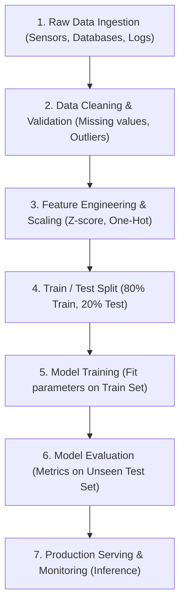

# The Machine Learning Pipeline (ML Pipeline)

A Machine Learning project in the real world is not just calling a model fitting function. It is a structured sequence of interconnected stages that transform messy, raw real-world data into a reliable production prediction system.

---

## 1. End-to-End Pipeline Architecture



---

## 2. Core Stages Breakdown

### 1. Data Preparation & Cleaning
- Remove duplicate rows.
- Handle missing values (imputation with mean/median or dropping).
- Cast types (e.g. converting date strings to timestamps or categorical labels to numbers).

### 2. Feature Scaling & Data Leakage Prevention
- **Golden Rule**: **Never touch test data during preprocessing!**
- Fit your scalers and encoders **only** on the training data:
  ```python
  # CORRECT:
  scaler.fit(X_train)
  X_train_scaled = scaler.transform(X_train)
  X_test_scaled = scaler.transform(X_test)  # Transform using TRAIN statistics!

  # WRONG (Data Leakage):
  scaler.fit(entire_dataset)  # Test set information leaks into training!
  ```

### 3. Model Training
- The algorithm optimizes its internal weights using only `X_train_scaled` and `y_train`.

### 4. Model Evaluation
- Compute test metrics ($R^2$, RMSE, Accuracy, F1-Score) on `X_test_scaled` and `y_test`.
- Diagnose model behavior:
  - High train error + High test error $\implies$ **Underfitting** (model is too simple).
  - Low train error + High test error $\implies$ **Overfitting** (model memorized noise).
  - Low train error + Low test error $\implies$ **Good Generalization**.

### 5. Inference Packaging
- In production, incoming raw data passes automatically through the trained preprocessing step before feeding into the model.
