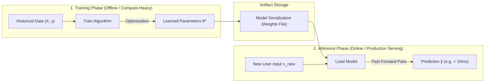

# Training vs Prediction vs Inference

In machine learning, developing a model and using it in production are two distinct stages with vastly different computational requirements and goals.

---

## 1. The Model Lifecycle

---

## 2. Key Terminology Breakdown

### 1. Training
- The process of iteratively finding optimal parameters ($\mathbf{w}, b$) that minimize a loss function.
- **Data Needed**: Both features $\mathbf{X}$ and true targets $\mathbf{y}$.
- **Computational Cost**: High (requires matrix gradients, backpropagation, multiple passes/epochs across millions of data points).
- **Environment**: Offline servers, GPUs, cloud clusters.

### 2. Prediction
- The mathematical act of running a single forward pass:
  $$\hat{y} = f(\mathbf{x}; \mathbf{w}, b)$$
- Given input vector $\mathbf{x}$, computing the estimated output $\hat{y}$.

### 3. Inference
- The deployment stage where a trained, **frozen** model serves predictions in production to real users or external applications.
- **Data Needed**: Only new input features $\mathbf{x}_{\text{new}}$ (targets $y$ are unknown—that's what we want to predict!).
- **Computational Cost**: Minimal (only basic forward arithmetic; no gradients, no loss calculation, no parameter updates).
- **Key Metrics in Production**:
  - **Latency**: Time taken to return a prediction for a single request (e.g., $< 20\text{ ms}$).
  - **Throughput**: Number of prediction requests served per second (RPS).

---

## 3. Comparison Summary

| Characteristic | Training Phase | Inference Phase |
|---|---|---|
| **Goal** | Learn optimal parameters $\boldsymbol{\theta}^*$ | Generate predictions for new inputs |
| **Input Data** | Features $\mathbf{X}$ + True Labels $\mathbf{y}$ | Features $\mathbf{x}_{\text{new}}$ only |
| **Parameters** | Mutable (updating every epoch) | **Frozen** (fixed, read-only) |
| **Operations** | Forward pass + Backward gradients + Updates | Forward pass only |
| **Execution** | Offline, scheduled, batch | Real-time, microservice, edge device |
| **Latency Tolerance** | Hours to days | Milliseconds ($< 50\text{ ms}$) |
