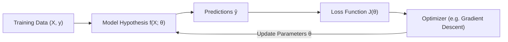

# What is Machine Learning? (Що таке Machine Learning)

**Machine Learning (ML)** is a subfield of Artificial Intelligence where computer systems learn to perform tasks by recognizing patterns in data, rather than following rigid, manually hardcoded rules.

---

## 1. Classical Programming vs Machine Learning

In traditional software engineering, a programmer designs specific deterministic rules. If new cases emerge, engineers must manually write more `if/else` statements.

```
Classical Programming:
Data   + Rules (Code)      ───▶  Answers

Machine Learning:
Data   + Answers (Labels)  ───▶  Rules (Trained Model)
```

- **Classical approach**:
  ```python
  def is_spam(email):
      if "free money" in email or "claim prize" in email:
          return True
      return False
  # Breaks as soon as spammers write "fre3 m0ney" or new phrases.
  ```

- **Machine Learning approach**:
  Feed 100,000 labeled emails into an algorithm. The algorithm automatically learns statistical word weights and predicts whether any new email is spam.

---

## 2. Formal Definitions

### Arthur Samuel (1959)
> *"Machine Learning is the field of study that gives computers the ability to learn without being explicitly programmed."*

### Tom Mitchell (1997)
> *"A computer program is said to learn from experience **$E$** with respect to some class of tasks **$T$** and performance measure **$P$**, if its performance at tasks in **$T$**, as measured by **$P$**, improves with experience **$E$**."*

### Example in Practice:
- **Task ($T$)**: Predict whether a transaction is fraudulent.
- **Experience ($E$)**: Historical dataset of 1,000,000 recorded bank transactions with known fraud outcomes.
- **Performance Measure ($P$)**: Classification accuracy or F1-Score on new transactions.

---

## 3. How a Model Learns: The Core Loop

Every ML algorithm follows this foundational mechanism:



1. **Hypothesis**: A mathematical function with tunable parameters $\boldsymbol{\theta}$ that transforms inputs into predictions ($\hat{y} = f(x; \boldsymbol{\theta})$).
2. **Loss Function**: Measures the discrepancy between prediction $\hat{y}$ and true ground-truth $y$.
3. **Optimization**: Updates parameters $\boldsymbol{\theta}$ to reduce the loss until the model generalizes well to unseen data.
