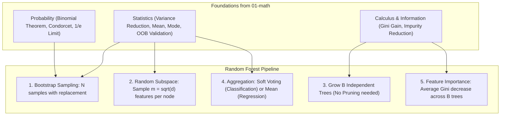

# Random Forest

**Random Forest** is an ensemble learning method that constructs a collection of decorrelated **Decision Trees** and aggregates their predictions. By combining **Bagging (Bootstrap Aggregation)** with **Random Feature Selection (Feature Bagging)**, it transforms individual high-variance decision trees into one of the most accurate, versatile, and noise-resilient algorithms in classical machine learning.

This folder contains practice exercises and conceptual notes covering Random Forests from first principles: ensemble theory and Condorcet's Jury Theorem, bootstrap sampling and the $1/e \approx 36.8\%$ Out-of-Bag (OOB) limit, variance reduction via bagging, feature subspace randomization ($m \approx \sqrt{d}$), prediction aggregation (hard vs soft voting), Mean Decrease in Impurity (MDI) feature importances, Decision Tree vs Random Forest tradeoffs, and complete implementations in both scikit-learn and pure NumPy from scratch.

Each subfolder has:
- `README.md` — theory, intuition, mathematical formulas, and examples
- `practice.py` — hands-on Python exercises implemented from first principles

---

## 🗺️ Roadmap & Modules

| # | Submodule | Core Concept | Why it matters in ML |
|---|---|---|---|
| 1 | **[Ensemble Learning](ensemble-learning/README.md)** | Condorcet's Theorem & Diversity | How combining independent weak/moderate predictors mathematically drives ensemble accuracy towards 100%. |
| 2 | **[Bootstrap Sampling](bootstrap-sampling/README.md)** | Sampling with replacement & OOB | Mathematical derivation showing why $\approx 36.8\%$ of data ($1/e$) is Out-of-Bag, providing free cross-validation. |
| 3 | **[Bagging](bagging/README.md)** | Variance reduction: $\text{Var}(\bar{f}) = \frac{\sigma^2}{B}$ | How training independent models in parallel stabilizes unstable base estimators and shrinks prediction variance. |
| 4 | **[Random Features](random-features/README.md)** | Feature Bagging ($m = \sqrt{d}$) | Restricting candidate split features to prevent dominant features from creating correlated trees ($\rho \to 0$). |
| 5 | **[Prediction Aggregation](prediction-aggregation/README.md)** | Hard voting vs Soft voting & Regression mean | Why averaging class probabilities (soft voting) outperforms discrete majority votes; uncertainty estimation. |
| 6 | **[Feature Importance](feature-importance/README.md)** | Mean Decrease in Impurity (MDI) | Summing sample-weighted Gini reductions ($\Delta I$) across trees to rank feature contributions. |
| 7 | **[Decision Tree vs Random Forest](decision-tree-vs-random-forest/README.md)** | Bias-Variance tradeoff & boundary smoothness | Comparing sharp orthogonal cuts vs smooth ensemble contours, and proving forests do not overfit as $B \to \infty$. |
| 8 | **[scikit-learn & From Scratch](scikit-learn/README.md)** | Production API & Full NumPy Implementation | Complete `RandomForestClassifier` matching `sklearn.ensemble` with OOB scoring, MDI importances, and parallel execution. |

---

## 📂 Directory Structure

```
random-forest/
├── ensemble-learning           # The wisdom of crowds, Condorcet theorem, diversity requirement
├── bootstrap-sampling          # Sampling with replacement, mathematical 1/e limit, OOB sets
├── bagging                     # Bootstrap Aggregating, variance reduction Var(f_bar) = sigma^2 / B
├── random-features             # Random subspace method (m = sqrt(d)), tree decorrelation
├── prediction-aggregation      # Majority voting vs probability averaging, regression uncertainty
├── feature-importance          # Mean Decrease in Impurity (MDI) / Gini Importance
├── decision-tree-vs-random-forest # Comprehensive side-by-side comparison & convergence
└── scikit-learn                # scikit-learn API, parallelization (n_jobs=-1), from-scratch class
```

---

## 🔗 How Math Connects to Random Forest



1. **Probability (`01-math/probability`)**: The Binomial distribution models Condorcet's Jury Theorem ($p \to 1$ as $B \to \infty$); limits of independent draws $(1 - 1/N)^N \to 1/e \approx 36.8\%$ define Out-of-Bag sampling.
2. **Statistics (`01-math/statistics`)**: The variance of the mean $\text{Var}(\bar{X}) = \frac{\sigma^2}{B}$ explains why ensembling reduces variance without hurting bias; inter-tree sample variance estimates prediction uncertainty.
3. **Calculus & Trees (`02-ml/decision-trees`)**: Each base learner recursively optimizes Gini impurity reduction $\Delta I$, which is accumulated across all trees to yield normalized feature importances.

---

## 🧭 Learning Path

Work through the submodules in numbered order:
1. Start with **[Ensemble Learning](ensemble-learning/README.md)** to understand how aggregating multiple models drives error down.
2. Master **[Bootstrap Sampling](bootstrap-sampling/README.md)** to see how data subsets and OOB samples are generated.
3. Study **[Bagging](bagging/README.md)** to see the mathematical mechanism of variance reduction.
4. Learn how **[Random Features](random-features/README.md)** decorrelates trees by testing $m \approx \sqrt{d}$ features at each split.
5. Explore aggregation strategies in **[Prediction Aggregation](prediction-aggregation/README.md)**.
6. Quantify model explainability in **[Feature Importance](feature-importance/README.md)**.
7. Understand the architectural differences in **[Decision Tree vs Random Forest](decision-tree-vs-random-forest/README.md)**.
8. Assemble the complete system in **[scikit-learn & From Scratch](scikit-learn/README.md)**.

