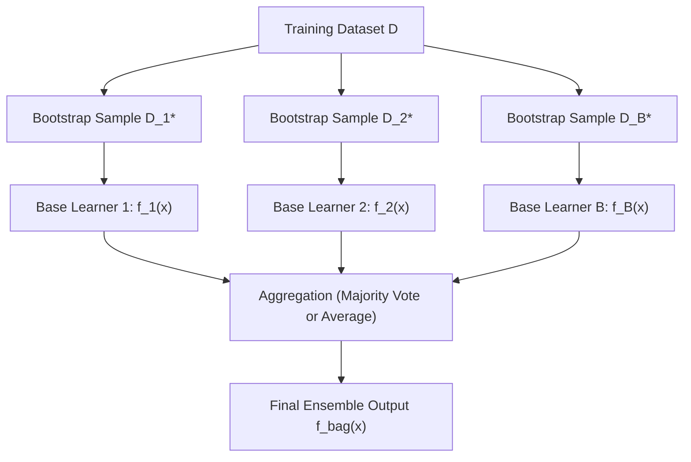

# Bagging (Bootstrap Aggregating)

**Bagging** (short for **B**ootstrap **Agg**regat**ing**), introduced by Leo Breiman in 1996, is an ensemble meta-algorithm designed to improve the stability and accuracy of high-variance machine learning models.

---

## 1. The Bagging Architecture

1. **Bootstrap:** Draw $B$ random bootstrap samples $\mathcal{D}_1^*, \dots, \mathcal{D}_B^*$ from the training set.
2. **Train:** Fit an independent base estimator $f_b(\mathbf{x})$ on each sample in parallel.
3. **Aggregate:**
   - **For Regression:** Arithmetic mean $\hat{y} = \frac{1}{B} \sum_{b=1}^B f_b(\mathbf{x})$.
   - **For Classification:** Majority vote $\hat{y} = \text{mode}\{f_1(\mathbf{x}), \dots, f_B(\mathbf{x})\}$.

---

## 2. Mathematical Justification: Variance Reduction

Why does averaging models improve performance?

Suppose each base model $f_b(\mathbf{x})$ has variance $\sigma^2$. If the models were completely independent (zero correlation):

$$\text{Var}\left(\frac{1}{B} \sum_{b=1}^B f_b(\mathbf{x})\right) = \frac{1}{B^2} \sum_{b=1}^B \text{Var}(f_b(\mathbf{x})) = \frac{B \sigma^2}{B^2} = \mathbf{\frac{\sigma^2}{B}}$$

By averaging $B$ models, **the prediction variance is reduced by a factor of $B$** while preserving the low bias of individual models!

### What happens when models are correlated ($\rho > 0$)?
In practice, models trained on the same underlying dataset have positive pairwise correlation $\rho = \text{Corr}(f_i, f_j) > 0$. The true variance of the ensemble average is:

$$\text{Var}\left(\bar{f}\right) = \rho \sigma^2 + \frac{1 - \rho}{B} \sigma^2$$

- As $B \to \infty$, the term $\frac{1-\rho}{B}\sigma^2 \to 0$.
- The residual variance is bounded below by **$\rho \sigma^2$**!
- **Key Insight:** To drive ensemble variance even lower, we must **decorrelate the trees** (reduce $\rho$). This is the exact breakthrough behind **Random Forests**.

---

## 3. Which Models Benefit Most from Bagging?

Bagging requires base learners that are **unstable and high-variance**:
- **Decision Trees:** Small changes in training data cause completely different splits and trees to be formed. **Ideal for Bagging!**
- **Linear Models (OLS, Logistic Regression):** Very stable (low variance, high bias). Bagging a linear model produces essentially the same line; little to no performance gain.

---

## Summary

- Bagging trains multiple base models on bootstrap samples and aggregates their predictions.
- **Reduces variance** significantly without compromising bias.
- Works best with high-variance base learners like unpruned Decision Trees.
- When trees are correlated, variance is bounded by $\rho \sigma^2$, motivating feature randomization.

**Previous:** [Bootstrap Sampling](../bootstrap-sampling/README.md) · **Next:** [Random Feature Selection](../random-features/README.md)

