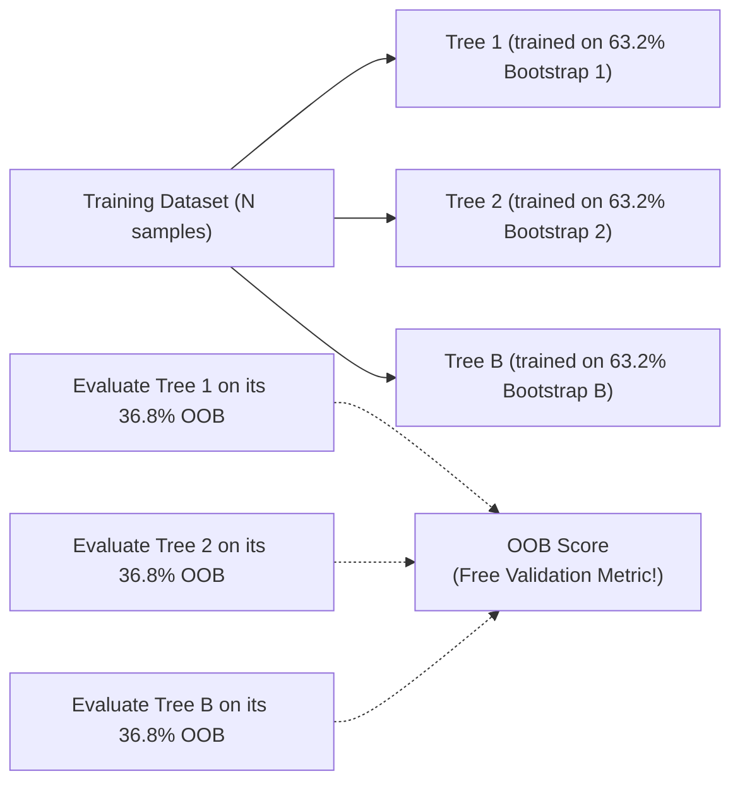

# Bootstrap Sampling & Out-of-Bag (OOB) Evaluation

**Bootstrap Sampling** (introduced by Bradley Efron in 1979) is the statistical engine behind Bagging and Random Forests. It provides a simple mechanism to create multiple diverse training datasets from a single fixed original dataset.

---

## 1. What is a Bootstrap Sample?

Given a dataset $\mathcal{D}$ containing $N$ samples:

A **Bootstrap Sample** $\mathcal{D}^*$ is constructed by randomly drawing $N$ samples from $\mathcal{D}$ **with replacement** (meaning each selected sample is immediately placed back and can be selected again).

```
   Original Dataset (N = 5):
   [ Sample 1, Sample 2, Sample 3, Sample 4, Sample 5 ]
                             │
     Draw with replacement  │
                             ▼
   Bootstrap Sample D* (N = 5):
   [ Sample 2, Sample 2, Sample 4, Sample 1, Sample 4 ]
   (Some samples appear multiple times; others never appear!)
```

Because samples are drawn with replacement:
- Some training instances appear multiple times in $\mathcal{D}^*$.
- Some training instances are **omitted entirely** from $\mathcal{D}^*$.

---

## 2. Mathematical Derivation of Out-of-Bag (OOB) Fraction

What is the probability that a specific sample $\mathbf{x}_i$ is **never** included in a bootstrap sample of size $N$?

1. At each individual draw, the probability of selecting $\mathbf{x}_i$ is $\frac{1}{N}$.
2. Therefore, the probability of **not** selecting $\mathbf{x}_i$ in a single draw is:
   $$P(\text{not chosen in 1 draw}) = 1 - \frac{1}{N}$$
3. Since draws are independent, the probability that $\mathbf{x}_i$ is not chosen in all $N$ draws is:
   $$P(\text{omitted in } N \text{ draws}) = \left(1 - \frac{1}{N}\right)^N$$
4. As the dataset size $N \to \infty$, this limit converges to the mathematical constant $e^{-1}$:
   $$\lim_{N \to \infty} \left(1 - \frac{1}{N}\right)^N = \frac{1}{e} \approx 0.367879 \dots \approx \mathbf{36.8\%}$$

### Consequence:
In every bootstrap sample:
- **$\approx 63.2\%$** of the unique training samples are included.
- **$\approx 36.8\%$** of the training samples are left out. These are called **Out-of-Bag (OOB)** samples!

---

## 3. Out-of-Bag (OOB) Evaluation

Because each tree in a forest is trained on only $\approx 63.2\%$ of the data, the remaining $36.8\%$ OOB samples serve as a **built-in, free validation set**!



### How OOB Score is Calculated:
1. For each training sample $\mathbf{x}_i$, find all trees that did **not** include $\mathbf{x}_i$ during training.
2. Aggregate the predictions of only those trees to predict sample $\mathbf{x}_i$.
3. Compute the accuracy (or error) across all $N$ samples.

**Benefit:** You can evaluate the true out-of-sample generalization performance of a Random Forest directly on the training set **without needing a separate train/validation split or k-fold cross-validation**!

---

## Summary

- Bootstrap sampling draws $N$ samples with replacement.
- Mathematically, $\approx 63.2\%$ of unique samples are selected, leaving $\approx 36.8\%$ as **Out-of-Bag (OOB)**.
- OOB samples provide an unbiased, built-in validation metric without sacrificing training data.

**Previous:** [Ensemble Learning](../ensemble-learning/README.md) · **Next:** [Bagging](../bagging/README.md)

