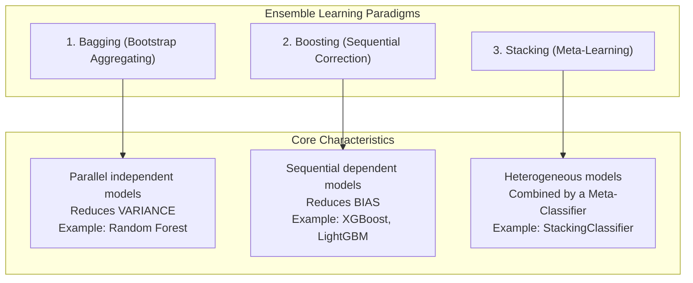

# Ensemble Learning

**Ensemble Learning** is a machine learning paradigm where multiple individual models (called **base learners** or estimators) are trained and combined to solve the same problem.

Instead of trying to build a single "perfect" model, an ensemble leverages the **Wisdom of Crowds**: aggregating predictions from a collection of diverse models consistently outperforms any individual model alone.

---

## 1. Mathematical Intuition: Condorcet's Jury Theorem

Suppose you have $B$ independent binary classifiers, each having an individual accuracy of $p = 0.60$ (slightly better than a random coin toss).

If the models make **independent errors**, the ensemble prediction via majority vote is correct whenever more than half of the models are correct. Using the **Binomial Distribution**:

$$P(\text{Ensemble Correct}) = \sum_{k=\lceil B/2 \rceil}^B \binom{B}{k} p^k (1-p)^{B-k}$$

| Number of Independent Models ($B$) | Individual Accuracy ($p$) | Ensemble Majority Vote Accuracy |
|---|:---:|:---:|
| 1 model | $60.0\%$ | $60.0\%$ |
| 11 models | $60.0\%$ | $75.3\%$ |
| 51 models | $60.0\%$ | $92.4\%$ |
| 101 models | $60.0\%$ | **$97.9\%$** |

As $B \to \infty$, the probability of a correct majority vote approaches $1.0$ (100%), provided that $p > 0.5$ and the errors are independent!

---

## 2. The Core Prerequisite: Diversity

The theorem only holds if the base models are **diverse** (their errors are uncorrelated).

```
   Homogeneous (Correlated) Models:             Diverse (Uncorrelated) Models:
   Model 1: [ ✓  ✓  ✗  ✓  ✗ ]                  Model 1: [ ✓  ✓  ✗  ✓  ✓ ]
   Model 2: [ ✓  ✓  ✗  ✓  ✗ ]                  Model 2: [ ✓  ✗  ✓  ✓  ✓ ]
   Model 3: [ ✓  ✓  ✗  ✓  ✗ ]                  Model 3: [ ✗  ✓  ✓  ✓  ✗ ]
   --------------------------                  --------------------------
   Vote:    [ ✓  ✓  ✗  ✓  ✗ ]                  Vote:    [ ✓  ✓  ✓  ✓  ✓ ]
   (No improvement: identical errors)          (Errors cancel out: 100% accurate!)
```

If every tree makes the exact same mistake on sample #3, majority voting will also make that mistake. The primary challenge in ensemble design is **inducing diversity** among the base models.

---

## 3. The Three Major Ensemble Paradigms



### 1. Bagging (Bootstrap Aggregating)
- **Structure:** Parallel and independent.
- **Mechanism:** Train multiple copies of the same high-variance base learner on different random bootstrap subsets of data.
- **Primary Goal:** **Reduce Variance** without increasing bias (smooth out erratic decision boundaries).
- **Representative Algorithm:** **Random Forest**.

### 2. Boosting
- **Structure:** Sequential and adaptive.
- **Mechanism:** Train models in sequence; each new model focuses heavily on samples misclassified by previous models.
- **Primary Goal:** **Reduce Bias** by converting weak learners into a strong learner.
- **Representative Algorithms:** AdaBoost, Gradient Boosting, XGBoost, CatBoost.

### 3. Stacking
- **Structure:** Hierarchical / Multi-level.
- **Mechanism:** Train different types of models (e.g. Logistic Regression, KNN, Decision Tree) in parallel, then use a second-level "meta-model" to combine their predictions.

---

## Summary

- Ensembles combine multiple diverse base learners to yield superior predictive performance and robustness.
- Condorcet's Jury Theorem proves that majority voting of independent predictors approaches certainty as ensemble size grows.
- **Bagging** reduces variance in parallel; **Boosting** reduces bias sequentially; **Stacking** blends diverse model families.

**Next:** [Bootstrap Sampling](../bootstrap-sampling/README.md)

