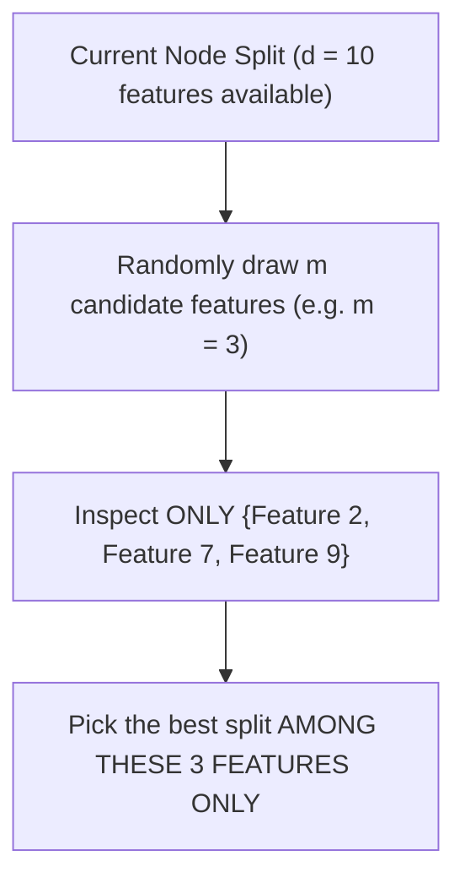

# Random Feature Selection (Feature Bagging)

While **Bagging** trains trees on different bootstrap sample rows, trees can still remain strongly correlated if certain features are overwhelmingly predictive.

**Random Feature Selection** (also known as the **Random Subspace Method**, introduced by Tin Kam Ho and perfected by Leo Breiman in 2001) is the defining breakthrough that transforms a standard Bagged Tree ensemble into a true **Random Forest**.

---

## 1. The Dominant Feature Problem in Pure Bagging

Suppose a medical dataset has 10 features, but one feature (e.g., *Blood Glucose Level*) is overwhelmingly more predictive than all others:

- In standard Bagging, **every single tree will select Blood Glucose for its root split**.
- Because the top splits across all $B$ trees are nearly identical, the trees produce correlated errors ($\rho \gg 0$).
- As shown in the variance formula:
  $$\text{Var}(\bar{f}) = \mathbf{\rho \sigma^2} + \frac{1 - \rho}{B} \sigma^2$$
  if $\rho$ is high, adding more trees cannot reduce the variance below $\rho \sigma^2$!

---

## 2. The Solution: Random Subspaces at Every Split

At **every single node split**, the algorithm is forbidden from looking at all $d$ features. Instead, it randomly draws a fresh subset of $m$ candidate features:



Even if Feature 1 is dominant across the entire dataset, it will only be considered in roughly $\frac{m}{d}$ of the nodes. Other nodes are forced to examine secondary and tertiary features, producing **radically decorrelated trees**!

---

## 3. Recommended Values for $m$ (`max_features`)

| Task Type | Recommended $m$ | Scikit-Learn Parameter | Example ($d = 64$ features) |
|---|:---:|:---:|:---:|
| **Classification** | $m = \lfloor\sqrt{d}\rfloor$ | `max_features="sqrt"` | $m = \sqrt{64} = \mathbf{8}$ features |
| **Regression** | $m = \lfloor\frac{d}{3}\rfloor$ | `max_features=1.0 / 3` | $m = \lfloor 64/3 \rfloor = \mathbf{21}$ features |

---

## 4. Bagging vs Random Forest Summary

```
                      Bagging                     Random Forest
Row Sampling:         Bootstrap (With replacement) Bootstrap (With replacement)
Feature Sampling:     All d features at each node  m = sqrt(d) random features per node
Tree Correlation (ρ): Moderate / High              Low (Deeply decorrelated)
Ensemble Variance:    Moderate                     Lowest
```

---

## Summary

- Pure Bagging suffers when dominant features make all trees look alike.
- Random Forest randomly restricts candidate split features to $m \approx \sqrt{d}$ at each node.
- This decorrelates the trees, slashing pairwise correlation $\rho$ and reducing overall ensemble variance.

**Previous:** [Bagging](../bagging/README.md) · **Next:** [Prediction Aggregation](../prediction-aggregation/README.md)

